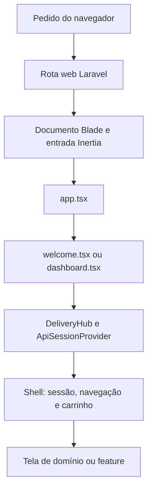
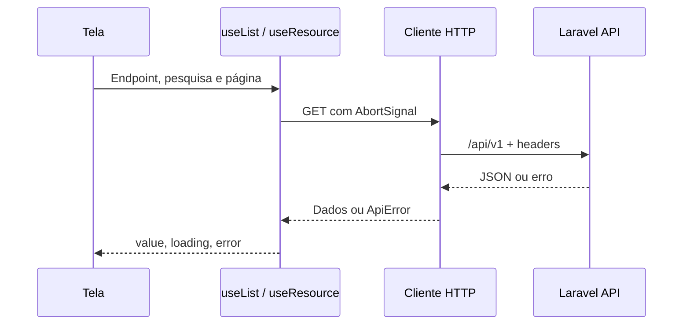

# Frontend DeliveryHub — percurso didático passo a passo

Este guia ensina o fluxo real do frontend, do primeiro pedido HTTP até à entrega de uma alteração. Deve ser lido na ordem das etapas na primeira utilização; depois pode ser usado como referência por assunto. Os exemplos correspondem aos ficheiros atuais do projeto.

## Como estudar este guia

1. Abrir os ficheiros indicados em cada etapa no editor.
2. Ler a explicação e acompanhar o caminho de dados, não apenas o aspeto da tela.
3. Executar o exercício num ambiente de desenvolvimento/testes, com contas apropriadas.
4. Comparar o resultado com o comportamento esperado e registar o que não foi testado.

**Pré-requisitos:** noções básicas de componentes React, props, estado, efeitos e HTTP. Cada etapa indica como esses conceitos aparecem neste projeto. Para começar a executar sem estudar tudo primeiro, seguir a etapa 2.

**Comandos de verificação:** `npm run types:check`, `npm run check`, `npm run test:frontend`, `npm run build`. A suíte documentada tem 50 testes em 7 ficheiros; consultar os limites dessa evidência na etapa de testes.

## Conceitos essenciais

| Conceito          | Significado neste projeto                                  |
| ----------------- | ---------------------------------------------------------- |
| Componente        | Função React que apresenta uma parte da interface          |
| Props             | Dados e callbacks recebidos por um componente              |
| Estado            | Informação que provoca novo render quando muda             |
| Hook              | Função React para reutilizar estado, efeitos ou contexto   |
| Provider/contexto | Forma de partilhar sessão com os componentes descendentes  |
| Reducer           | Função que recebe estado e ação e devolve o próximo estado |
| Efeito            | Ligação a algo externo, como HTTP, timer ou armazenamento  |
| Serviço           | Módulo que concentra contratos e operações de um domínio   |
| Endpoint          | Caminho e método HTTP de uma operação da API               |
| Resource          | Forma JSON que o backend escolhe expor ao consumidor       |
| Mutação           | Operação que cria ou altera dados, como POST ou PATCH      |
| Mock              | Substituto controlado de uma dependência durante um teste  |
| Chunk             | Parte dos assets carregada separadamente quando necessária |

## Índice do percurso

1. [Conhecer a aplicação e as tecnologias](#1-conhecer-a-aplicação-e-as-tecnologias)
2. [Preparar o ambiente e abrir as telas](#2-preparar-o-ambiente-e-abrir-as-telas)
3. [Aprender a estrutura de pastas](#3-aprender-a-estrutura-de-pastas)
4. [Acompanhar o arranque da primeira tela](#4-acompanhar-o-arranque-da-primeira-tela)
5. [Seguir a navegação e a gestão de estado](#5-seguir-a-navegação-e-a-gestão-de-estado)
6. [Percorrer login, sessão e permissões](#6-percorrer-login-sessão-e-permissões)
7. [Seguir uma consulta da tela até à API](#7-seguir-uma-consulta-da-tela-até-à-api)
8. [Pesquisar enquanto escreve e paginar](#8-pesquisar-enquanto-escreve-e-paginar)
9. [Estudar um CRUD completo com categorias](#9-estudar-um-crud-completo-com-categorias)
10. [Adicionar pratos e restaurar o carrinho](#10-adicionar-pratos-e-restaurar-o-carrinho)
11. [Concluir o pedido e recuperar de falhas](#11-concluir-o-pedido-e-recuperar-de-falhas)
12. [Acompanhar pedidos, detalhes e dashboard](#12-acompanhar-pedidos-detalhes-e-dashboard)
13. [Entender eventos e reconexão](#13-entender-eventos-e-reconexão)
14. [Tratar validação e mensagens de erro](#14-tratar-validação-e-mensagens-de-erro)
15. [Compor a interface e disponibilizar Android](#15-compor-a-interface-e-disponibilizar-android)
16. [Executar e escrever testes automatizados](#16-executar-e-escrever-testes-automatizados)
17. [Validar o fluxo completo no navegador](#17-validar-o-fluxo-completo-no-navegador)
18. [Diagnosticar problemas pela camada certa](#18-diagnosticar-problemas-pela-camada-certa)
19. [Implementar uma alteração e preparar a entrega](#19-implementar-uma-alteração-e-preparar-a-entrega)

- [Limitações e funcionalidades pendentes](#limitações-e-funcionalidades-pendentes)
- [Evidência de verificação](#evidência-de-verificação)
- [Histórico da simplificação](#histórico-da-simplificação)

## 1. Conhecer a aplicação e as tecnologias

**Objetivo:** entender o que o frontend faz e o que continua a ser responsabilidade do servidor.

**Abra estes ficheiros:** [`package.json`](package.json), [`resources/js/app.tsx`](resources/js/app.tsx) e [`vite.config.ts`](vite.config.ts).

O frontend apresenta os dados e recolhe ações do utilizador. O backend verifica permissões, valida os dados, calcula preços e grava as alterações. Uma interface que esconde uma ação não substitui a autorização da API.

Neste projeto coexistem **dois fluxos**: páginas web Inertia/Fortify e uma aplicação de portal/gestão que navega por fragmentos da URL e consome JSON. Distingui-los evita tentar utilizar um token API como se fosse uma sessão web, ou tratar uma resposta JSON como uma página Inertia.

### Tecnologias e ficheiros de configuração

| Elemento                           | Utilização no projeto                                         |
| ---------------------------------- | ------------------------------------------------------------- |
| React 19 e TypeScript              | Telas, componentes, estado e tipos dos contratos              |
| Inertia 3                          | Arranque, entradas de páginas e autenticação/definições web   |
| Laravel e Sanctum                  | API, autenticação por token e autorização no servidor         |
| Vite 8 através do Vite+ (`vp`)     | Servidor de desenvolvimento, build, formatação, lint e testes |
| Tailwind CSS 4                     | Estilos utilitários e tokens globais                          |
| Radix UI                           | Primitivos acessíveis de diálogos e componentes existentes    |
| Lucide React e Sonner              | Ícones e notificações globais                                 |
| Laravel Echo e Pusher JS           | Cliente websocket compatível com Reverb                       |
| Wayfinder                          | Geração de actions/rotas TypeScript para os fluxos web        |
| Vitest através de `vite-plus/test` | Testes de regras e serviços HTTP do frontend                  |

As versões exatas são fixadas em `package-lock.json`; `package.json` define os intervalos aceites. Usar `npm ci` para reproduzir a instalação. O backend usa `composer.lock`.

| Ficheiro                             | Responsabilidade                                                              |
| ------------------------------------ | ----------------------------------------------------------------------------- |
| `package.json` / `package-lock.json` | Dependências JavaScript e comandos disponíveis                                |
| `vite.config.ts`                     | Entradas, plugins React/Inertia/Tailwind/Wayfinder, fontes, lint e formatação |
| `tsconfig.json`                      | TypeScript estrito, JSX e alias `@/*` para `resources/js/*`                   |
| `vitest.frontend.config.ts`          | Testes em ambiente Node, alias e padrão de descoberta                         |
| `resources/css/app.css`              | Tailwind, tokens de cores, tipografia, raios e estilos base                   |
| `resources/views/app.blade.php`      | Documento HTML que monta o Inertia e inclui os assets                         |
| `.github/workflows/deploy.yml`       | Verificações automáticas e build de produção                                  |

A interface React foi ligada aos contratos existentes em `routes/api.php`, `routes/api/*`, controllers, Form Requests, API Resources, ações de domínio e canais de broadcasting. Não foram alterados controllers, rotas, modelos, migrations, configuração PHP ou ficheiros Composer.

A aplicação Inertia continua a arrancar em `resources/js/app.tsx`. As páginas `welcome.tsx` e `dashboard.tsx` apresentam agora o portal e a área de gestão. As páginas originais de autenticação web e definições continuam disponíveis nas rotas existentes.

Não existem dados comerciais de exemplo no novo portal: listas, detalhes, pedidos e indicadores vêm da API. Carrinho e avisos são estado local do React.

### Exercício de verificação

Localize no `package.json` os scripts `dev`, `types:check`, `check`, `test:frontend` e `build`. Explique para que serve cada um antes de os executar. Não confunda compilação aprovada com um fluxo de compra validado.

## 2. Preparar o ambiente e abrir as telas

**Objetivo:** conseguir executar o projeto com dependências, schema e serviços apropriados.

**Abra estes ficheiros:** [`package.json`](package.json), [`.env.example`](.env.example), [`database/seeders/SuperAdminSeeder.php`](database/seeders/SuperAdminSeeder.php) e [`routes/web.php`](routes/web.php).

Siga esta ordem numa instalação nova: configurar o ambiente, instalar dependências, preparar chave e migrations, preparar contas de teste, iniciar Laravel e Vite e só depois abrir a aplicação. Os comandos de preparação detalhados abaixo não devem substituir um `.env` já configurado.

Para testar apenas as regras JavaScript, não precisa de base de dados. Para testar as telas contra a API real, precisa das migrations e das contas corretas. Reverb e filas são necessários para comprovar a entrega de eventos, não para executar os testes unitários.

Com o servidor Laravel e Vite habituais do projeto em execução, abrir a raiz da aplicação:

| Ecrã                   | Caminho                   |
| ---------------------- | ------------------------- |
| Portal público         | `/#portal`                |
| Menu de um restaurante | `/#restaurant/ID`         |
| Carrinho               | `/#cart`                  |
| Checkout               | `/#checkout`              |
| Autenticação API       | `/#login`                 |
| Registo de cliente     | `/#register`              |
| Recuperação de acesso  | `/#forgot`                |
| Dashboard              | `/#dashboard`             |
| Pedidos / detalhe      | `/#orders` / `/#order/ID` |
| Restaurantes           | `/#restaurants`           |
| Categorias             | `/#categories`            |
| Produtos               | `/#products`              |
| Criar membro da equipa | `/#team`                  |

Os fragmentos `#...` permitem testar e navegar sem adicionar rotas PHP. A rota `/dashboard` existente também apresenta a área de gestão, mas mantém o middleware de autenticação web original. Para uma sessão exclusivamente API, usar `/#dashboard`.

Comandos:

```sh
composer install
npm ci
npm run dev
# Noutro terminal, se não estiver a usar o Herd:
php artisan serve
```

Os testes automatizados de frontend usam respostas simuladas e não precisam de base de dados. Para testar as telas contra a API real, a base deve estar configurada e ter **todas as migrations aplicadas**. Uma base sem restaurantes ativos produz uma lista vazia; uma base com schema incompleto pode produzir erros HTTP.

### Preparação inicial

Requisitos: PHP compatível com `composer.json` (pelo menos 8.3), Composer e Node compatível com as dependências. O pipeline utiliza Node 22. Herd pode servir a aplicação Laravel sem `php artisan serve`.

Num checkout novo, copiar `.env.example` para `.env` **apenas se `.env` ainda não existir** e configurar a ligação à base de dados destinada a desenvolvimento. Não substituir o `.env` já configurado.

```sh
composer install
php artisan key:generate
php artisan migrate:status
php artisan migrate
npm ci
```

`key:generate` é uma preparação inicial para um ambiente novo, não um passo de rotina num ambiente que já tem chave e sessões em uso. `migrate` aplica as migrations pendentes. Não usar `migrate:fresh` para preparar testes numa base com dados a preservar.

O build executa Wayfinder, pelo que também depende de Laravel arrancar corretamente, mesmo quando a alteração é apenas visual. Se necessário, gerar os ficheiros explicitamente:

```sh
php artisan wayfinder:generate --with-form
```

### Conta de super administrador

O ficheiro `database/seeders/SuperAdminSeeder.php` lê `SUPER_ADMIN_EMAIL` e `SUPER_ADMIN_PASSWORD` do ambiente. Não existe uma palavra-passe fixa no código.

Exemplo de configuração — substituir por valores próprios de desenvolvimento:

```dotenv
SUPER_ADMIN_EMAIL=admin@example.test
SUPER_ADMIN_PASSWORD="SubstituirPorUmaSenhaForteCom16CaracteresOuMais"
```

A palavra-passe do super administrador deve ter pelo menos **16 caracteres**. Após guardar:

```sh
php artisan config:clear
php artisan db:seed --class=SuperAdminSeeder
```

O seeder cria ou atualiza a conta do email indicado, incluindo palavra-passe e papel. Não deve ser executado inadvertidamente para redefinir credenciais existentes. Não publicar `.env`, tokens, palavras-passe reais ou capturas com esses valores.

Para registo de clientes e criação de membros/administrador inicial pela API, o requisito de palavra-passe é de 12 caracteres, conforme os Form Requests existentes; é diferente do requisito do seeder.

### Variáveis utilizadas pelo navegador

| Variável              | Utilização                                                      |
| --------------------- | --------------------------------------------------------------- |
| `VITE_APP_NAME`       | Nome usado nos títulos Inertia; fallback para `Delivery Hub`    |
| `VITE_REVERB_APP_KEY` | Chave pública do cliente Reverb; ativa a tentativa de websocket |
| `VITE_REVERB_HOST`    | Host acessível pelo navegador, sem esquema ou caminho           |
| `VITE_REVERB_PORT`    | Porta websocket acessível pelo navegador                        |
| `VITE_REVERB_SCHEME`  | `http` para WS local ou `https` para WSS                        |

Variáveis `VITE_*` são públicas e entram nos assets. Não colocar nelas `REVERB_APP_SECRET`, credenciais da base ou tokens privados. Reiniciar `npm run dev` após alterações às variáveis; em produção, reconstruir os assets.

Para desenvolvimento local com um servidor Reverb configurado em `localhost:8080`, o cliente pode usar:

```dotenv
VITE_REVERB_APP_KEY="${REVERB_APP_KEY}"
VITE_REVERB_HOST=localhost
VITE_REVERB_PORT=8080
VITE_REVERB_SCHEME=http
```

Estes valores têm de corresponder ao serviço real. Não ativam nem configuram o servidor por si próprios. O frontend usa API da mesma origem (`/api/v1`), não uma variável com domínio externo.

### Serviços para tempo real

Quando a configuração de broadcasting e filas do ambiente exigir esses processos, executar em terminais separados:

```sh
php artisan reverb:start
php artisan queue:work
```

Em produção, esses processos pertencem à infraestrutura gerida pela equipa backend. O frontend não modifica a configuração de filas ou broadcasting.

Para testar fluxos autenticados, utilizar contas de desenvolvimento disponibilizadas pela equipa. O registo no portal e as ações de gestão criam e alteram dados reais na base ligada.

### Exercício de verificação

1. Abrir `/#portal` e confirmar se a API devolve restaurantes ou uma lista vazia.
2. Abrir `/#login` para o fluxo API e `/login` para o fluxo web; observar que são telas/contratos diferentes.
3. Consultar `php artisan migrate:status` se aparecer um erro de coluna/tabela inexistente.
4. Confirmar que nenhum segredo foi copiado para código, documentação ou capturas.

## 3. Aprender a estrutura de pastas

**Objetivo:** saber onde encontrar e onde colocar cada responsabilidade.

**Abra estes ficheiros:** [`resources/js`](resources/js), [`resources/js/domains`](resources/js/domains), [`resources/js/shared`](resources/js/shared) e [`resources/js/features`](resources/js/features).

Comece pela entrada e percorra as camadas. `pages` liga o Inertia à aplicação; `application` compõe a navegação e os providers; `domains` contém as áreas de negócio; `features` combina domínios; `shared` fornece infraestrutura comum.

A organização acompanha os domínios do backend sem copiar a sua implementação. Não colocar uma chamada HTTP dentro de um ícone, nem uma regra comercial dentro de um componente visual genérico.

A organização usa os mesmos cinco domínios existentes em `app/Domains`: `Users`, `Restaurants`, `Categories`, `Products` e `Orders`. No frontend os nomes usam minúsculas e ficheiros TS/TSX. Não se copiam Repositories/Actions PHP para o navegador: persistência, autorização e transações continuam no servidor.

```text
resources/js/
├── app.tsx                         # Arranque do Inertia e providers globais
├── application/
│   ├── DeliveryHub.tsx             # Composição da aplicação, carrinho e menu
│   └── use-view.ts                  # Navegação local por fragmentos da URL
├── domains/
│   ├── users/
│   │   ├── types.ts                # UserResource, papéis e resposta de login
│   │   ├── permissions.ts          # Papel e contexto de equipa
│   │   ├── services.ts             # Login, registo, sessão e criação de membro
│   │   ├── context/session.tsx     # ApiSessionProvider e useSession
│   │   └── pages/                  # auth.tsx e team.tsx
│   ├── restaurants/
│   │   ├── types.ts                # RestaurantResource
│   │   ├── permissions.ts          # Permissão para editar restaurante
│   │   ├── services.ts             # Consultas, criação, edição e desativação
│   │   └── pages/restaurants.tsx   # Gestão de restaurantes
│   ├── categories/
│   │   ├── types.ts                # CategoryResource
│   │   ├── services.ts             # Gestão e opções paginadas de categorias
│   │   └── pages/categories.tsx    # Gestão de categorias
│   ├── products/
│   │   ├── types.ts                # ProductResource, preço decimal e stock
│   │   ├── services.ts             # Catálogo público e mutações de produto
│   │   └── pages/products.tsx      # Gestão de catálogo e stock
│   └── orders/
│       ├── types.ts                # OrderResource, itens e payload de checkout
│       ├── rules.ts                # Quatro estados, transições, payload e canais
│       ├── cart.ts                 # Estado e regras do carrinho
│       ├── cart-storage.ts         # Validação, leitura e gravação do carrinho
│       ├── hooks/use-cart.ts       # Estado persistido e associação à conta
│       ├── services.ts             # Endpoints por ator e operações de pedido
│       ├── realtime/connection.ts  # Echo/Reverb e autorização do canal
│       ├── components/            # Estado da ligação e badge de pedido
│       ├── pages/                 # cart.tsx, checkout.tsx e orders.tsx
│       └── __tests__/             # Contratos de pedidos, permissões e valores
├── features/
│   ├── portal/
│   │   ├── pages/portal.tsx        # Vitrine de restaurantes e produtos
│   │   ├── components/add-dish-button.tsx # Adicionar com contador por prato
│   │   ├── components/android-download.tsx # Link Android ou disponibilidade futura
│   │   ├── config/android-download.ts # Endereços APK/Play Store aceites
│   │   └── __tests__/android-download.test.ts # Configuração e apresentação
│   └── dashboard/pages/dashboard.tsx # Resumo de dados dos domínios
├── shared/
│   ├── api/
│   │   ├── client.ts              # /api/v1, token, JSON, erros e request ID
│   │   ├── types.ts               # Resource<T>, Page<T> e estado ativo/inativo
│   │   ├── payload.ts             # Seleção de campos aceites pelo backend
│   │   ├── pagination.ts          # Query string sem perder filtros existentes
│   │   └── __tests__/             # Testes do cliente HTTP
│   ├── errors/
│   │   ├── messages.ts            # Mensagens de erro em português
│   │   └── __tests__/             # Validação das mensagens
│   ├── hooks/use-api.ts           # Consultas abortáveis, paginação e mutations
│   ├── components/
│   │   ├── api-ui.tsx             # Campos, formulários, erros e confirmações
│   │   └── catalog-state.tsx      # Campo/badge ativo ou inativo
│   └── utils/                     # money.ts e date.ts
├── __tests__/integration/         # Serviços e contratos entre domínios
├── pages/
│   ├── welcome.tsx                # Entrada Inertia para DeliveryHub
│   ├── dashboard.tsx              # Entrada Inertia para a área de gestão
│   ├── auth/                      # Autenticação web original (Fortify)
│   └── settings/                  # Definições web originais
├── layouts/                       # Layouts das restantes páginas Inertia
└── components/ui/                 # Primitivos visuais e acessíveis existentes
```

### Responsabilidade de cada camada

- `pages/`: entradas resolvidas pelo Inertia. As páginas internas de domínio são compostas pela aplicação e não criam rotas PHP automaticamente.
- `application/`: junta os providers, navegação, estado do carrinho e menu por papel. Não define os contratos HTTP dos domínios.
- `domains/*/types.ts`: representa os campos realmente expostos pelos API Resources. Alterações futuras a um Resource devem começar neste ficheiro e no serviço correspondente.
- `domains/*/services.ts`: concentra os endpoints e os métodos HTTP. Nas operações de formulário, seleciona apenas os campos aceites pelos Form Requests. Um campo visual adicional não é enviado por acidente como permissão, restaurante ou credencial.
- `rules.ts` e `permissions.ts`: regras para apresentar ações válidas e orientar o utilizador. As verificações do backend continuam a decidir a autorização final.
- `features/`: telas que combinam vários domínios, como portal e dashboard. Consultam os serviços e tipos dos domínios sem duplicar contratos.
- `shared/`: infraestrutura reutilizável, sem dependências de regras comerciais específicas. Um diálogo de confirmação recebe uma função de ação; não precisa de conhecer rotas de produtos, restaurantes ou pedidos.
- `__tests__/`: testes junto do código quando tratam um módulo e testes de integração separados quando verificam a composição entre domínios.

### Correspondência com a lógica do servidor

| Backend                                                     | Frontend                                    | Responsabilidade                          |
| ----------------------------------------------------------- | ------------------------------------------- | ----------------------------------------- |
| `app/Domains/Users` e rotas `api/auth.php`, `api/users.php` | `domains/users`                             | Sessão, papéis e criação de membro        |
| `app/Domains/Restaurants`                                   | `domains/restaurants`                       | Restaurante e administrador inicial       |
| `app/Domains/Categories`                                    | `domains/categories`                        | Categorias do restaurante autenticado     |
| `app/Domains/Products`                                      | `domains/products`                          | Preço, stock, categoria e disponibilidade |
| `app/Domains/Orders`                                        | `domains/orders`                            | Checkout, pedidos, transições e canais    |
| `app/Http/Resources`                                        | `domains/*/types.ts`, `shared/api/types.ts` | Dados e paginação recebidos               |
| `app/Http/Requests/Api`                                     | `domains/*/services.ts`, formulários        | Campos enviados e erros por campo         |

A pasta anterior `marketplace` e o ficheiro conjunto `Management.tsx` foram substituídos por estes módulos. Os imports apontam diretamente para os módulos novos, sem ficheiros de compatibilidade ou cópias da implementação antiga. O módulo de Echo passou de `lib/echo.ts` para `domains/orders/realtime/connection.ts`.

As pastas geradas `actions`, `routes` e `wayfinder` continuam a pertencer ao Wayfinder; não devem ser editadas manualmente. Os componentes e layouts do starter que suportam autenticação e definições web foram preservados.

### Ajustes de lógica nesta reorganização

- O serviço de pedidos escolhe `/orders` para cliente e `/restaurant/orders` para equipa com restaurante associado. Super administrador e contas sem contexto não recebem um endpoint de pedidos indevido.
- Antes de enviar uma transição, o serviço verifica estado, papel e, para a equipa, pertença do pedido ao restaurante. O servidor volta a validar a operação.
- A listagem administrativa de um administrador de restaurante inclui o filtro `id` do restaurante associado. Super administrador usa a listagem geral. A limitação de autenticação opcional no índice público, descrita abaixo, permanece dependente do backend.
- A construção da paginação preserva filtros que já existam na URL, evitando perder o `id` ao pesquisar ou mudar de página.
- A criação de restaurante envia as credenciais do administrador inicial; a edição envia apenas os campos editáveis do restaurante.
- Produtos enviam somente nome, tipo, preço, quantidade, categoria e estado. O restaurante do produto é determinado pelo backend a partir do utilizador.
- O carregamento de opções de categorias percorre as páginas do paginator dentro do serviço de categorias e pode ser cancelado ao sair da tela.

### Exercício de verificação

Localize a tela de categorias, o serviço de categorias e o tipo `Category`. Depois localize `ApiForm` e explique por que ele está em `shared` e não em `domains/categories`.

## 4. Acompanhar o arranque da primeira tela

**Objetivo:** entender como uma rota Laravel termina num componente React visível.

**Abra estes ficheiros:** [`routes/web.php`](routes/web.php), [`resources/views/app.blade.php`](resources/views/app.blade.php), [`resources/js/app.tsx`](resources/js/app.tsx), [`resources/js/pages/welcome.tsx`](resources/js/pages/welcome.tsx) e [`resources/js/pages/dashboard.tsx`](resources/js/pages/dashboard.tsx).

1. O navegador pede uma rota web, por exemplo `/`.
2. A rota escolhe a entrada Inertia `welcome`.
3. O documento Blade inclui os assets e o ponto de montagem.
4. `app.tsx` inicia o Inertia, define título/layouts e monta os providers globais.
5. `pages/welcome.tsx` monta `DeliveryHub`; `pages/dashboard.tsx` monta a mesma aplicação com `initial="dashboard"`.
6. `DeliveryHub` monta `ApiSessionProvider` e o shell. O shell lê sessão, vista e carrinho e escolhe o conteúdo.
7. Se a tela for carregada sob demanda, `Suspense` mostra «A carregar…» até o módulo estar pronto.



Estes dois ficheiros são pequenos de propósito:

```tsx
// resources/js/pages/welcome.tsx
import DeliveryHub from '@/application/DeliveryHub';
export default function Welcome() {
    return <DeliveryHub />;
}
```

```tsx
// resources/js/pages/dashboard.tsx
import DeliveryHub from '@/application/DeliveryHub';
export default function Dashboard() {
    return <DeliveryHub initial="dashboard" />;
}
```

A tela com indicadores está em `features/dashboard/pages/dashboard.tsx`. Não é necessário copiar esses indicadores para a entrada Inertia. Além disso, um fragmento já presente na URL tem prioridade sobre a vista inicial.

### Exercício de verificação

Abra os dois `dashboard.tsx` no editor. Identifique qual é a entrada e qual implementa a tela. No navegador, compare `/`, `/#portal` e `/#dashboard`; a última opção pede sessão API para mostrar a área privada.

## 5. Seguir a navegação e a gestão de estado

**Objetivo:** entender o que muda num clique e onde ficam os dados durante a utilização.

**Abra estes ficheiros:** [`resources/js/application/use-view.ts`](resources/js/application/use-view.ts), [`resources/js/application/DeliveryHub.tsx`](resources/js/application/DeliveryHub.tsx) e [`resources/js/shared/hooks/use-api.ts`](resources/js/shared/hooks/use-api.ts).

1. Um item do menu aponta para um fragmento, por exemplo `#categories`.
2. A alteração dispara `hashchange`.
3. `useView` atualiza a vista em estado React.
4. O shell escolhe a tela correspondente e mantém a estrutura partilhada.
5. O menu é construído de acordo com o papel. As telas e serviços também verificam o contexto necessário.

`/#categories` não cria uma rota PHP `/categories`. O fragmento é interpretado pelo navegador. Já `/settings/profile` é uma rota web real do Laravel.

Props são dados recebidos por um componente; estado é informação que o componente/provider conserva entre renders; um efeito liga esse estado a uma operação externa, como uma consulta HTTP. Alterar `revision` pede uma nova consulta, não uma edição direta dos dados no servidor.

### Onde vive cada estado

| Estado                              | Local                                     | Duração e recuperação                                                  |
| ----------------------------------- | ----------------------------------------- | ---------------------------------------------------------------------- |
| Token Sanctum                       | `sessionStorage`, com fallback em memória | Restauro por `/auth/me`; limpeza em logout/401                         |
| Utilizador API                      | Contexto `ApiSessionProvider`             | Obtido por login/registo ou `/auth/me`                                 |
| Sessão web                          | Cookie/sessão Laravel                     | Fluxo separado, gerido por Fortify                                     |
| Carrinho                            | `useCart` e `sessionStorage`              | Mantido entre telas e reloads na mesma aba; limpo ao sair/trocar conta |
| Filtros, página e dados de listagem | Hooks da tela                             | Recarregados ao entrar; pesquisa muda a página para 1                  |
| Formulário e erros                  | Componente de formulário                  | Preservados durante falha; não há autosave persistente                 |
| Aparência                           | `localStorage` e cookie `appearance`      | Modo claro, escuro ou sistema dos componentes web existentes           |
| Estado websocket                    | Componente `Connection`                   | Recriado por sessão; listeners e ligação limpos ao sair                |

O portal não tem Redux, Zustand, cache persistente de consultas ou service worker. O carrinho persiste na sessão da aba; não há sincronização entre dispositivos nem navegação funcional offline garantida.

### Hooks e componentes comuns

| Módulo/export                                     | Como utilizar                                                                         |
| ------------------------------------------------- | ------------------------------------------------------------------------------------- |
| `useResource<T>(path, revision)`                  | GET abortável; `null` desativa a consulta; expõe `value`, `loading`, `error`, `retry` |
| `useList<T>(endpoint, revision, perPage, search)` | GET paginado; expõe `go`, `page`, `refresh` e os estados da consulta                  |
| `useMutation()`                                   | Executa uma ação com bloqueio síncrono, `busy` e erro contextual                      |
| `useSession()`                                    | Acede ao utilizador, restauro, autenticação e logout dentro do provider               |
| `Title`, `Empty`, `LoadState`, `Feedback`         | Cabeçalhos e estados consistentes das telas                                           |
| `SearchBox`, `Pagination`                         | Pesquisa por digitação com debounce de 300 ms e paginação por números                 |
| `Fields`, `ApiForm`                               | Campos, labels, mensagens 422 do backend e envio sem validação HTML                   |
| `EditDialog`, `ConfirmAction`                     | Edição e confirmação acessíveis; a ação é uma função de serviço                       |
| `stateField`, `ActiveBadge`                       | Estado `active`/`inactive` de catálogo                                                |
| `OrderBadge`                                      | Um dos quatro estados reais de pedido                                                 |

As consultas usam `AbortController` para cancelar trabalho quando a tela muda. Não apresentar a resposta antiga de outra URL como se pertencesse à pesquisa atual. Aumentar `revision` ou chamar `retry`/`refresh` para voltar a consultar após uma alteração confirmada.

### Exercício de verificação

Navegue do portal para o carrinho e volte. Observe que o shell não precisa de perder o estado. Depois recarregue a página e identifique quais os dados restaurados do armazenamento e quais são consultados novamente.

## 6. Percorrer login, sessão e permissões

**Objetivo:** perceber o ciclo completo de autenticação API e a distinção do login web.

**Abra estes ficheiros:** [`resources/js/domains/users/pages/auth.tsx`](resources/js/domains/users/pages/auth.tsx), [`resources/js/domains/users/services.ts`](resources/js/domains/users/services.ts) e [`resources/js/domains/users/context/session.tsx`](resources/js/domains/users/context/session.tsx).

1. O utilizador abre `/#login` e preenche o formulário.
2. `ApiForm` recolhe os campos e chama `authenticate` do contexto.
3. O contexto usa `userApi.authenticate`, que envia o contrato de login.
4. A API devolve `{ user, token }` em caso de sucesso.
5. O provider guarda o token da aba, atualiza o utilizador e a tela navega para `#dashboard`.
6. As chamadas protegidas seguintes enviam Bearer através do cliente comum.
7. Num reload, o provider consulta `/auth/me` para confirmar a sessão; não aceita o papel apenas porque ficou escrito no navegador.
8. Logout revoga o token atual no servidor e limpa a sessão local após sucesso. Um 401 também invalida o token local.

O registo cria uma conta de cliente, não uma conta de staff. A criação de membros está na área Equipa e exige o papel e contexto definidos pelo backend.

### Autenticação e autorização

- Login e registo usam `POST /api/v1/auth/login` e `/auth/register`, com a resposta real `{ user, token }`.
- O token Sanctum é guardado em `sessionStorage` da aba, com alternativa em memória se o armazenamento estiver bloqueado. Não é escrito em `localStorage` nem apresentado na interface.
- O restauro consulta `GET /api/v1/auth/me`; um 401 invalida a sessão local. Logout chama `/auth/logout` antes de limpar o estado.
- Registo pede confirmação da palavra-passe e mínimo de 12 caracteres. Recuperação chama `/auth/forgot-password`; a reposição pelo link mantém o fluxo web já existente.
- A autenticação API é independente da sessão Fortify. Entrar em `/login` não cria automaticamente um token para o portal, e entrar em `/#login` não autentica automaticamente as rotas web protegidas.
- Papéis reais: `customer`, `staff`, `restaurant_admin`, `super_admin`. A interface esconde menus e ações incompatíveis, mas o backend continua responsável por autorizar cada operação.

| Papel                        | Interface disponibilizada                                                        |
| ---------------------------- | -------------------------------------------------------------------------------- |
| Cliente                      | Portal, carrinho, checkout, pedidos próprios, cancelamento enquanto pendente     |
| Staff                        | Categorias, produtos e pedidos do restaurante associado                          |
| Administrador do restaurante | Operações de staff, edição do próprio restaurante e criação de membros da equipa |
| Super administrador          | Criação/edição/desativação de restaurantes e criação do administrador inicial    |

Não se inventaram permissões de entregador/operador nem uma listagem global de pedidos para o super administrador: esses contratos não estão expostos nesta API.

### Exercício de verificação

Entre com uma conta de teste de cada papel e compare os menus. Depois confirme que abrir manualmente um fragmento privado não concede acesso. Teste um 401 com mocks, sem publicar o token real.

## 7. Seguir uma consulta da tela até à API

**Objetivo:** entender como são carregados os restaurantes, produtos e outras listagens.

**Abra estes ficheiros:** [`resources/js/features/portal/pages/portal.tsx`](resources/js/features/portal/pages/portal.tsx), [`resources/js/shared/hooks/use-api.ts`](resources/js/shared/hooks/use-api.ts), [`resources/js/shared/api/client.ts`](resources/js/shared/api/client.ts) e os serviços do domínio.

1. A tela escolhe um endpoint definido pelo domínio, por exemplo `restaurantEndpoints.list`.
2. `useList` combina endpoint, página, quantidade por página e pesquisa.
3. `useResource` inicia a consulta e coloca `loading` a verdadeiro.
4. O cliente comum acrescenta prefixo, headers e credenciais apropriadas.
5. O backend valida e devolve um Resource ou paginator.
6. O hook guarda os dados e termina o loading, ou guarda uma mensagem de erro.
7. A tela escolhe entre loading, erro, lista vazia e conteúdo.

Os serviços concentram as rotas e as mutações, mas algumas consultas de listagem são executadas pelo hook a partir do endpoint do serviço. Não existe um Repositório de base de dados JavaScript no navegador.



Uma consulta antiga é cancelada quando a sua URL deixa de ser a atual. Isto evita tratar a pesquisa anterior como se fosse o resultado da nova.

### Campos principais dos Resources

| Tipo         | Campos de negócio consumidos                                                                              |
| ------------ | --------------------------------------------------------------------------------------------------------- |
| `ApiUser`    | `id`, `name`, `email`, `role`, `restaurant_id` (pode ser `null`)                                          |
| `Restaurant` | `id`, `name`, `address`, `phone_number`, `nif`, `status`                                                  |
| `Category`   | `id`, `restaurant_id`, `name`, `status`                                                                   |
| `Product`    | `id`, `restaurant_id`, `category_id`, `category?`, `name`, `type`, `price`, `quantity`, `status`          |
| `Order`      | `id`, `restaurant_id`, `restaurant?`, `customer?`, `status`, `total`, `address`, `delivery_date`, `items` |
| `OrderItem`  | `id`, `product_id`, `product_name`, `quantity`, `unit_price`, `line_total`                                |

Recursos comerciais incluem ainda os timestamps indicados nos ficheiros `types.ts`. Relações opcionais dependem de o backend as carregar. `product_name` pode ser `null`; a tela apresenta um identificador como alternativa. Não depender de campos internos do modelo que o Resource não expõe.

Resposta individual: `{ "data": { ... } }`. Login/registo usam `{ "user": { ... }, "token": "..." }`. A listagem paginada tem `data`, `links` e `meta`, com `current_page`, `last_page`, `per_page`, `total`, `from` e `to`; `from`/`to` podem ser `null` na lista vazia.

### Métodos HTTP por operação

Todos os caminhos abaixo têm prefixo `/api/v1`:

| Operação                                  | Método e caminho                                                           |
| ----------------------------------------- | -------------------------------------------------------------------------- |
| Login / registo / recuperação             | POST `/auth/login`, `/auth/register`, `/auth/forgot-password`              |
| Restaurar sessão / sair                   | GET `/auth/me`, POST `/auth/logout`                                        |
| Listar / consultar restaurante            | GET `/restaurants`, GET `/restaurants/{id}`                                |
| Criar / editar / desativar restaurante    | POST `/restaurants`, PATCH `/restaurants/{id}`, DELETE `/restaurants/{id}` |
| Menu público                              | GET `/restaurants/{id}/products`                                           |
| Criar / editar / desativar produto        | POST `/products`, PATCH `/products/{id}`, DELETE `/products/{id}`          |
| Listar categorias                         | GET `/categories`                                                          |
| Criar / editar / desativar categoria      | POST `/categories`, PATCH `/categories/{id}`, DELETE `/categories/{id}`    |
| Criar membro da equipa                    | POST `/restaurant/users`                                                   |
| Listar / consultar pedidos do cliente     | GET `/orders`, GET `/orders/{id}`                                          |
| Criar / cancelar pedido                   | POST `/orders`, POST `/orders/{id}/cancel`                                 |
| Listar / consultar pedidos do restaurante | GET `/restaurant/orders`, GET `/restaurant/orders/{id}`                    |
| Atualizar estado pela equipa              | PATCH `/restaurant/orders/{id}/status`                                     |

Não acrescentar `/api/v1` duas vezes ao chamar os serviços. Não usar o router Inertia para endpoints que devolvem JSON puro. Os formulários web originais continuam a usar os contratos Inertia/Fortify e rotas geradas pelo Wayfinder.

### Exercício de verificação

No separador Network, abrir um restaurante e identificar o GET do detalhe e o GET dos produtos. Comparar o JSON com os tipos em `types.ts`; não procurar campos de modelo que o Resource não expõe.

## 8. Pesquisar enquanto escreve e paginar

**Objetivo:** seguir o caminho do texto digitado até à lista filtrada, sem botão de pesquisa.

**Abra estes ficheiros:** [`resources/js/shared/components/api-ui.tsx`](resources/js/shared/components/api-ui.tsx), [`resources/js/shared/api/pagination.ts`](resources/js/shared/api/pagination.ts) e a tela consultada.

1. `SearchBox` atualiza o valor local em cada alteração do input.
2. Um timer espera 300 ms sem uma nova alteração; o timer anterior é limpo.
3. `onSearch` atualiza o estado de pesquisa da tela.
4. `useList` passa a usar a primeira página e constrói `name` na query string.
5. A consulta anterior é substituída e a nova resposta atualiza a lista.
6. Limpar o input remove o filtro. Enter permite antecipar a pesquisa.

Exemplo ilustrativo de URL, sem fixar IDs reais: `/api/v1/restaurants?per_page=12&page=1&name=Casa`. Quando existe um filtro `id`, `listUrl` mantém esse filtro ao acrescentar os restantes parâmetros.

Paginar não significa carregar toda a base no navegador. O frontend utiliza a página e os totais devolvidos pelo servidor; não calcula um total global com o comprimento de uma única página.

### Exercício de verificação

Prepare mais de 12 registos de teste. Pesquise sem Enter, avance uma página, altere a pesquisa e confirme a primeira página. Limpe o campo e confirme a reposição dos resultados sem perder o filtro de restaurante.

## 9. Estudar um CRUD completo com categorias

**Objetivo:** acompanhar leitura, criação, edição, erro e desativação numa área concreta.

**Abra estes ficheiros:** [`resources/js/domains/categories/pages/categories.tsx`](resources/js/domains/categories/pages/categories.tsx), [`resources/js/domains/categories/services.ts`](resources/js/domains/categories/services.ts) e [`resources/js/shared/components/api-ui.tsx`](resources/js/shared/components/api-ui.tsx).

Use esta tela como exemplo para aprender as restantes áreas de gestão.

### Passo A — entrar e carregar a lista

1. O shell escolhe `CategoriesManagement` para `#categories`.
2. A tela obtém o utilizador através de `useSession`.
3. `isTeam(user)` verifica papel de equipa e restaurante associado.
4. Quando esse contexto existe, `useList<Category>` consulta o endpoint de categorias. Caso contrário, o endpoint é `null` e a consulta não começa.
5. `LoadState`, `Empty` e a listagem apresentam o estado da operação.

### Passo B — abrir o formulário

1. O clique em «Nova categoria» executa `setEdit('new')`.
2. O estado faz aparecer `EditDialog` e `ApiForm`.
3. Os campos são apresentados pelo componente `Fields`.
4. Os inputs não impedem o envio por validação HTML. A indicação de campo obrigatório é informativa.

### Passo C — enviar para o serviço

A chamada real é equivalente a:

```ts
categoryApi.save(edit === 'new' ? null : edit.id, data);
```

Com `id === null`, o serviço usa POST `/categories`; com ID, usa PATCH `/categories/{id}`. `payloadFields` seleciona somente `name` e `status`. Um campo visual extra não é automaticamente enviado como permissão ou restaurante.

Exemplo de corpo JSON:

```json
{
    "name": "Pratos de teste",
    "status": "active"
}
```

### Passo D — receber sucesso ou erro

Em sucesso, o callback fecha o diálogo, mostra confirmação e chama `list.refresh()`. A lista volta a ser consultada no servidor; não se inventa um registo definitivo apenas porque o utilizador carregou em Guardar.

Em 422, o cliente constrói `ApiError`; `ApiForm` apresenta mensagens por campo e mantém os dados para correção. O bloqueio de envio é libertado depois de a chamada terminar. Nenhum erro do backend deve ser convertido numa confirmação falsa.

### Passo E — editar ou desativar

Editar coloca o objeto em `edit`, preenchendo o formulário com os dados recebidos. Desativar coloca-o em `remove` e abre `ConfirmAction`. Só a confirmação chama `categoryApi.deactivate(id)`. Depois de sucesso, a lista é atualizada.

A mesma sequência existe, com os campos próprios, nas áreas de restaurantes e produtos. A área Equipa tem criação, mas não uma listagem/edição de membros que o backend não fornece.

### Catálogo e gestão

- Restaurantes: GET/POST `/restaurants`, PATCH/DELETE `/restaurants/{id}`. A criação envia também `admin_name`, `admin_email` e `admin_password`, exigidos pelo backend.
- Catálogo público: GET `/restaurants/{id}/products`. Campos reais incluem `category_id`, `type`, `price`, `quantity` e `status`.
- Produtos: POST `/products`, PATCH/DELETE `/products/{id}`. Categorias: GET/POST `/categories`, PATCH/DELETE `/categories/{id}`.
- Equipa: POST `/restaurant/users`, com confirmação da palavra-passe. O backend não disponibiliza uma lista/edit/delete de membros; a interface não simula essas operações.
- Desativação tem confirmação e só atualiza a interface depois de resposta bem-sucedida.
- Formulários apresentam erros 422 por campo, erro geral, estado de envio e proteção contra duplo clique.
- Pesquisa usa `name`; a paginação usa `page`/`per_page`, `data`, `links` e `meta` do paginator Laravel, incluindo o total devolvido pelo servidor. Não usa cursor pagination porque este backend não a fornece.

### Exercício de verificação

Com uma conta de equipa de teste: criar «Pratos de teste», pesquisar pelo nome, editar e desativar. Submeter um nome inválido/duplicado num ambiente de teste e confirmar que o erro é do backend, que os dados não desaparecem e que não houve criação falsa.

## 10. Adicionar pratos e restaurar o carrinho

**Objetivo:** entender como uma ação local atualiza quantidades e sobrevive a um reload.

**Abra estes ficheiros:** [`resources/js/features/portal/components/add-dish-button.tsx`](resources/js/features/portal/components/add-dish-button.tsx), [`resources/js/domains/orders/cart.ts`](resources/js/domains/orders/cart.ts), [`resources/js/domains/orders/hooks/use-cart.ts`](resources/js/domains/orders/hooks/use-cart.ts) e [`resources/js/domains/orders/cart-storage.ts`](resources/js/domains/orders/cart-storage.ts).

1. O portal recebe os itens do carrinho e a função `onAdd` do shell.
2. O botão de um prato apresenta a quantidade desse produto nos itens reais.
3. Um clique envia a ação `add` ao reducer.
4. O reducer aplica restaurante único, stock conhecido e limite por item, devolvendo um novo estado sem alterar o anterior.
5. O cabeçalho soma as quantidades. O botão de cada prato lê a quantidade correspondente; não mantém um contador separado.
6. `useCart` grava os itens e o ID da conta na sessão da aba.
7. Num reload, o initializer restaura os dados válidos antes de apresentar os contadores.

Adicionar ao carrinho não reserva stock e não cria um pedido. Os preços e quantidades guardados são a última informação conhecida. O backend continua a decidir disponibilidade e total no checkout.

`domains/orders/hooks/use-cart.ts` usa `cart-storage.ts` para restaurar o carrinho ao montar a aplicação e gravar alterações na chave `deliveryhub.cart.v1` do `sessionStorage`. São guardados itens, quantidades e ID da conta associada, sem morada, palavra-passe ou token nesse registo.

A implementação espera pelo restauro da sessão antes de interpretar uma mudança de conta como logout. Se a consulta de sessão falhar temporariamente e o token continuar presente, não apaga imediatamente o carrinho. O login de visitante preserva os itens; logout, mudança de conta, limpeza manual e checkout confirmado removem os itens persistidos.

JSON corrompido, versões desconhecidas, duplicados, restaurantes misturados e quantidades inválidas são descartados. Se o armazenamento for bloqueado pelo navegador, o estado continua funcional em memória. O carrinho pertence à sessão da aba; não é sincronizado entre dispositivos e não constitui um carrinho persistente no servidor.

Preços e stock restaurados são a última informação conhecida. O checkout continua a usar preços calculados e disponibilidade validada pelo backend.

### Teste de atualização do navegador

1. Adicionar um prato e confirmar o contador no cabeçalho e no botão.
2. Atualizar a página na mesma aba e confirmar que as quantidades permanecem.
3. Abrir o carrinho, alterar a quantidade, atualizar e verificar o resumo.
4. Limpar o carrinho, atualizar e confirmar que os itens não reaparecem.
5. Repetir com login na mesma conta, logout e mudança de conta, usando fixtures de teste.
6. Confirmar mensagens de stock se a disponibilidade tiver mudado no servidor.

A suíte `cart-storage.test.ts` cobre restauro, associação à conta, limpeza, conteúdo corrompido, limites e armazenamento bloqueado. A verificação manual de reload já confirmou a conservação da quantidade no navegador; o fluxo completo de checkout autenticado continua dependente de dados e serviços de teste.

### Exercício de verificação

Adicionar um prato, abrir o carrinho e recarregar a página na mesma aba. Confirmar quantidade no resumo, cabeçalho e botão do prato. Depois remover o prato e recarregar: os itens não devem reaparecer. Não esperar sincronização com outro dispositivo.

## 11. Concluir o pedido e recuperar de falhas

**Objetivo:** seguir a primeira mutação comercial do cliente, com confirmação do servidor.

**Abra estes ficheiros:** [`resources/js/domains/orders/pages/checkout.tsx`](resources/js/domains/orders/pages/checkout.tsx), [`resources/js/domains/orders/rules.ts`](resources/js/domains/orders/rules.ts) e [`resources/js/domains/orders/services.ts`](resources/js/domains/orders/services.ts).

1. O cliente abre `#checkout` com itens e uma sessão API de cliente.
2. A tela apresenta a morada, data opcional e resumo calculado a partir dos itens.
3. O submit impede o comportamento padrão do formulário e usa um bloqueio síncrono para evitar chamadas repetidas enquanto processa.
4. `checkoutPayload` monta os campos do contrato, sem enviar preços calculados pelo navegador.
5. `orderApi.create` chama POST `/orders`.
6. O backend valida, calcula o total e confirma a criação.
7. O frontend mostra o ID e total recebidos, limpa o carrinho e oferece acompanhamento.
8. Em 422, mantém os itens/dados para corrigir. Em falha de rede/5xx, orienta a consultar os pedidos antes de repetir, porque o resultado pode ser incerto.

A regra de apresentação em AOA não converte preços de outra moeda. Valores decimais são convertidos para inteiros em centavos para a soma, e a confirmação do servidor prevalece.

### Carrinho e checkout

- Apenas um restaurante por pedido; adicionar um produto de outro restaurante não apaga o carrinho existente.
- Quantidades limitadas pelo stock conhecido e pelo limite de 100 unidades por produto; máximo de 50 produtos distintos. Produtos inativos ou sem stock não podem ser adicionados.
- O carrinho é guardado no `sessionStorage` da aba e restaurado ao atualizar a página. Login na mesma aplicação preserva-o; logout ou mudança de utilizador autenticado limpa-o.
- A API envia preços como valores decimais (`"18.50"`), não como centavos. O frontend converte-os para inteiros em centavos para somar e depois formata em kwanzas (AOA). Nunca multiplica diretamente valores monetários com ponto flutuante.

Payload efetivamente enviado a `POST /api/v1/orders`:

```json
{
    "restaurant_id": 1,
    "address": "Morada de entrega",
    "delivery_date": "2026-10-23",
    "items": [{ "product_id": 10, "quantity": 2 }]
}
```

`delivery_date` é omitida se estiver em branco. Não se enviam preços, totais, `address_id` ou `payment_method`: o servidor calcula o preço e valida stock, disponibilidade e restaurante.

O formulário mantém a página e os dados em erros, apresenta validação por campo/item e mensagens de stock. O envio tem bloqueio síncrono e estado de loading. Em sucesso, usa o número e total retornados pelo servidor, limpa o carrinho e oferece acompanhamento.

Em falha de rede ou erro 5xx, o resultado pode ser incerto. A interface orienta a consultar os pedidos antes de desbloquear outra tentativa. `X-Request-Id` é um UUID novo por pedido HTTP e serve para correlação; **não é uma chave de idempotência**. A API não implementa deduplicação de checkout, por isso não há reenvio automático.

O checkout usa JSON via cliente HTTP, porque os controllers entregues devolvem API Resources/erros JSON e não redirecionamentos Inertia. Não usa `useForm`/`router.post` contra esses endpoints, evitando respostas incompatíveis com o protocolo Inertia.

### Exercício de verificação

Com dados de teste, concluir um pedido e comparar o total confirmado com a resposta HTTP. Depois executar o cenário de stock desatualizado e perda de resposta descrito na etapa de falhas. Não reenviar automaticamente um checkout que pode ter sido gravado.

## 12. Acompanhar pedidos, detalhes e dashboard

**Objetivo:** distinguir as ações do cliente, da equipa e as métricas realmente disponíveis.

**Abra estes ficheiros:** [`resources/js/domains/orders/pages/orders.tsx`](resources/js/domains/orders/pages/orders.tsx), [`resources/js/domains/orders/services.ts`](resources/js/domains/orders/services.ts) e [`resources/js/features/dashboard/pages/dashboard.tsx`](resources/js/features/dashboard/pages/dashboard.tsx).

1. `orderEndpoint(user)` escolhe pedidos do cliente ou pedidos do restaurante, ou `null` se o papel não tem esse contrato.
2. A listagem mostra os dados paginados e o botão «Ver detalhes» muda a vista para `#order/{id}`.
3. O detalhe faz nova consulta autorizada; não depende apenas da linha previamente mostrada.
4. `transitions` define ações apresentáveis segundo o estado e papel.
5. A confirmação chama o serviço, que também verifica a pertença do pedido ao restaurante da equipa antes do envio.
6. O backend confirma ou recusa a transição. A interface volta a consultar os dados após sucesso.

O dashboard é uma composição das mesmas fontes de dados, não um endpoint independente de estatísticas globais. O valor de pedidos não é prova de receita paga.

### Pedidos e dashboard

Estados reais, provenientes de `OrderStatus`:

| Estado        | Rótulo        | Ações na interface                                   |
| ------------- | ------------- | ---------------------------------------------------- |
| `pending`     | Pendente      | Cliente cancela; equipa inicia preparação ou cancela |
| `in_progress` | Em preparação | Equipa conclui ou cancela                            |
| `completed`   | Concluído     | Sem transições                                       |
| `cancelled`   | Cancelado     | Sem transições                                       |

Cliente consulta `/orders` e `/orders/{id}` e cancela em `/orders/{id}/cancel`. A equipa consulta `/restaurant/orders` e atualiza `/restaurant/orders/{id}/status`. O detalhe mostra morada, data, itens, quantidades e valores reais. O campo `status` do Resource representa o fluxo de pedido apesar do nome interno `payment_status` no modelo.

O dashboard usa as mesmas listagens: total global da listagem apenas quando fornecido por `meta.total`; contagens por estado, valor e gráfico referem-se explicitamente à página carregada. O valor de pedidos não é apresentado como receita paga, pois não existe confirmação de pagamentos na API. Super administrador vê restaurantes, sem inventar estatísticas globais de encomendas.

### Exercício de verificação

Criar um pedido com cliente de teste e usar a equipa do mesmo restaurante para iniciar e concluir a preparação. Confirmar que os estados terminais não apresentam novas ações e que um super administrador não recebe operações de staff.

## 13. Entender eventos e reconexão

**Objetivo:** perceber como um evento provoca nova consulta sem substituir os dados autoritativos.

**Abra estes ficheiros:** [`resources/js/domains/orders/realtime/connection.ts`](resources/js/domains/orders/realtime/connection.ts) e [`resources/js/domains/orders/components/connection.tsx`](resources/js/domains/orders/components/connection.tsx).

1. Com sessão e configuração pública adequadas, o cliente cria Echo/Reverb.
2. Obtém cookie XSRF e solicita autorização do canal privado com o token.
3. Subscreve o canal correto para cliente ou equipa.
4. Um evento de estado é validado e pede atualização dos dados.
5. A tela volta a consultar a API; o evento não substitui a verificação do servidor.
6. Perda de ligação muda o estado apresentado. Reconexão volta a sincronizar dados; sair limpa listeners e subscrição.

A atualização periódica de 30 segundos é uma alternativa quando a aba está visível e online. Ver a tela mudar depois de 30 segundos, por si só, não comprova que o websocket funciona.

### Tempo real

- Cliente subscreve `orders.{user.id}` — o sufixo é o **ID do cliente**, não o ID do pedido.
- Equipa subscreve `restaurant.{restaurant_id}`.
- Evento real: `.order.status.updated`, com `order_id`, `restaurant_id` e `status`.
- A ligação só é criada com utilizador, token e `VITE_REVERB_APP_KEY`. A autorização usa `/sanctum/csrf-cookie` e `/broadcasting/auth`, com token Bearer e cabeçalho XSRF, conforme o middleware existente.
- Echo/Reverb reconecta, apresenta estado e permite nova tentativa em falhas de autorização/ligação. As subscrições e listeners são limpos ao sair.
- Listas de pedidos e dashboard voltam a consultar o servidor após eventos/reconexão. Existe também atualização de 30 em 30 segundos com a página visível e online, cobrindo alterações que não emitam evento.
- A aplicação usa as variáveis públicas `VITE_REVERB_APP_KEY`, `VITE_REVERB_HOST`, `VITE_REVERB_PORT`, `VITE_REVERB_SCHEME` já previstas no projeto; o serviço Reverb e a infraestrutura de filas devem estar operacionais para entrega de eventos. Nenhuma configuração backend foi alterada.

### Exercício de verificação

Usar cliente e equipa em perfis separados. Observar o evento no instante da mudança de estado e a consulta HTTP seguinte. Interromper só o websocket, recuperar o serviço e confirmar reconexão sem confundir com a atualização periódica.

## 14. Tratar validação e mensagens de erro

**Objetivo:** seguir a resposta de erro até à mensagem acessível apresentada ao utilizador.

**Abra estes ficheiros:** [`resources/js/shared/api/client.ts`](resources/js/shared/api/client.ts), [`resources/js/shared/errors/messages.ts`](resources/js/shared/errors/messages.ts), [`resources/js/shared/components/api-ui.tsx`](resources/js/shared/components/api-ui.tsx) e [`resources/js/components/input-error.tsx`](resources/js/components/input-error.tsx).

1. A API devolve um estado HTTP e, quando aplicável, `errors` por campo.
2. O cliente preserva estado e referência, normaliza os erros e cria `ApiError`.
3. O formulário associa os campos e mostra um resumo da falha.
4. O catálogo transforma mensagens conhecidas em português e evita expor detalhes internos.
5. O utilizador corrige os dados e submete novamente; não se passa a validar tudo com HTML para impedir a chamada.

Exemplo da transformação, não de validação no navegador:

```text
Backend: The email field is required.
Frontend: Preencha o campo «Email».
```

`noValidate` permite enviar o formulário ao backend. O asterisco e `aria-required` comunicam o contrato, mas não bloqueiam o envio. Loading, permissões de apresentação e regras do carrinho são controlos de interação distintos da validação nativa HTML.

### Cliente HTTP e erros

`shared/api/client.ts` define o prefixo `/api/v1`, JSON, `credentials: same-origin`, Bearer quando aplicável, XSRF quando existe cookie e um `X-Request-Id` por chamada. Pedidos públicos de login/registo não enviam Bearer. URLs de outra origem são rejeitadas pelo cliente.

`ApiError` transporta `status`, `fields` e `requestId`. O campo `errors` do Laravel é normalizado para uma mensagem por campo. Uma mensagem de domínio pode vir apenas em `message`; não pressupor que todo 422 contém `errors`.

| Situação                    | Tratamento/validação esperados                                                |
| --------------------------- | ----------------------------------------------------------------------------- |
| 401                         | Token local invalidado e sessão API terminada; solicitar novo login           |
| 403                         | Apresentar recusa; não inventar outra rota para contornar a permissão         |
| 404                         | Apresentar o erro do recurso e permitir regressar à listagem                  |
| 419                         | Mensagem de sessão expirada; relevante sobretudo para fluxos web/broadcasting |
| 422 com `errors`            | Mostrar erro junto do campo/item e permitir corrigir                          |
| 422 com apenas `message`    | Mostrar mensagem contextual, por exemplo stock insuficiente                   |
| 429                         | Mostrar erro retornado; não fazer tentativas automáticas ilimitadas           |
| 5xx ou falha de rede        | Mensagem de falha; no checkout, confirmar se houve criação antes de repetir   |
| Sucesso sem JSON inesperado | Mensagem de resposta inesperada; 204 é aceite como ausência de corpo          |

Os tipos TypeScript não validam JSON em tempo de execução. Mudanças incompatíveis nos Resources continuam a poder provocar falhas; validar contratos nos serviços/testes e manter o backend como fonte da verdade.

`shared/errors/messages.ts` centraliza `friendlyMessage`, `fieldLabel` e `httpMessage`. O cliente HTTP normaliza mensagens antes de construir `ApiError`; `input-error.tsx`, `alert-error.tsx` e notificações flash de erro usam o mesmo catálogo nos fluxos web.

| Caso                           | Apresentação                                                 |
| ------------------------------ | ------------------------------------------------------------ |
| Campo obrigatório              | Pedido em português para preencher o campo identificado      |
| Email inválido                 | Orientação para introduzir um endereço válido                |
| Confirmação de palavra-passe   | Indicação de que os dois valores não correspondem            |
| Comprimento ou limite numérico | Valor mínimo/máximo indicado pelo servidor                   |
| Credenciais incorretas         | Mensagem específica de email ou palavra-passe incorretos     |
| Sessão expirada                | Pedido de novo login                                         |
| Conta inativa                  | Orientação para contactar o administrador                    |
| 403                            | Falta de permissão, sem oferecer ações de outro papel        |
| 404                            | Registo indisponível; voltar à listagem e atualizar          |
| 429                            | Aguardar antes de repetir                                    |
| 5xx ou erro técnico            | Mensagem de indisponibilidade sem SQL, paths ou stack traces |
| Falha de rede                  | Orientação para verificar a ligação                          |
| Stock insuficiente             | Mensagem de negócio preservada                               |

`items.1.quantity` é apresentado como «Quantidade do prato 2». O resumo dos 422 não repete o texto inglês «and 1 more error». O estado HTTP e o `X-Request-Id` são preservados para diagnóstico; a validação continua no backend.

Mensagens desconhecidas e não técnicas mantêm-se como recebidas. Para uma nova mensagem em inglês, acrescentar correspondência e teste em `shared/errors/__tests__/messages.test.ts`; não inventar uma causa ou uma regra de validação no navegador.

### Exercício de verificação

Enviar login vazio em desenvolvimento e confirmar pedido HTTP e mensagens em português. Consultar os testes para 403/404/429/5xx em vez de provocar falhas deliberadas na base real. Confirmar que não foi reintroduzido `required` ou `pattern` como bloqueio nativo.

## 15. Compor a interface e disponibilizar Android

**Objetivo:** perceber estilos partilhados, acessibilidade, carregamento e configuração de download.

**Abra estes ficheiros:** [`resources/css/app.css`](resources/css/app.css), [`resources/js/shared/components/api-ui.tsx`](resources/js/shared/components/api-ui.tsx), [`resources/js/app.tsx`](resources/js/app.tsx) e [`resources/js/features/portal/components/android-download.tsx`](resources/js/features/portal/components/android-download.tsx).

As cores e os componentes comuns ajudam a manter consistência, mas não substituem testar contraste, foco e responsividade. A preferência web claro/escuro/sistema não significa que todas as telas do portal tenham um tema escuro completo.

O botão Android representa uma aplicação existente: não transforma o build React num APK. Sem um ficheiro ou página real configurada, apresenta «Disponível em breve».

### Estilos e personalização

O portal e a gestão usam Tailwind, superfícies claras, tons slate e destaque laranja. Os estilos de campos e botões comuns estão em `shared/components/api-ui.tsx`; os tokens globais estão em `resources/css/app.css`.

A preferência claro/escuro/sistema das telas web existentes é mantida por `hooks/use-appearance.tsx`, pela classe `dark` no HTML e pelo cookie de aparência. As telas novas têm várias cores explícitas e **não implementam uma adaptação completa ao modo escuro**. Não existe neste estado um seletor de 20 temas, nem persistência de personalização global de marca na API.

Para alterar o tema, começar pelos estilos partilhados e pelos tokens realmente usados. Rever botões, foco, badges, mensagens e fundos em todas as telas; não alterar apenas uma cor de destaque e considerar a aplicação inteira validada. A moeda atual é AOA (kwanza angolano), com código `AOA` explícito e formatação monetária `pt-AO`; não existe seleção de moeda por restaurante. A apresentação em AOA mantém os números recebidos da API, sem aplicar câmbio. Todos os preços e totais usam `shared/utils/money.ts`. As datas usam a formatação local do navegador em português.

O portal usa placeholders gráficos para produtos porque o Resource não fornece imagem/descrição. Não apresentar imagens de exemplo como se tivessem sido publicadas pelo restaurante.

### Verificações visuais e de acessibilidade

- Rever em 360 px, 768 px e 1280 px ou mais, usando o modo responsivo do navegador.
- Confirmar menu móvel, cabeçalho, botões, formulários, diálogos e resumo do checkout sem sobreposição.
- As tabelas podem ter scroll horizontal dentro do contentor; não devem empurrar a página inteira para fora do ecrã.
- Navegar apenas com Tab, Shift+Tab, Enter, Espaço e Escape. Confirmar foco visível e ordem compreensível.
- Testar o link «Saltar para o conteúdo»; deve focar o conteúdo sem substituir o fragmento de navegação.
- Conferir labels, campos obrigatórios, `aria-invalid`, associação de mensagens e anúncios de loading/sucesso/erro.
- Num diálogo, verificar foco inicial, contenção de foco, fecho por teclado e retorno ao elemento que o abriu.
- Confirmar que estados não dependem só da cor: o texto «Pendente», «Concluído» ou a mensagem de erro deve continuar visível.
- Testar zoom a 200% e nomes/moradas longos. Verificar contraste com as ferramentas de acessibilidade do navegador.

Estas verificações são um roteiro manual. Não existe atualmente uma auditoria automática de acessibilidade ou garantia de conformidade integral.

### Carregamento e desempenho

`React.lazy`/`Suspense` dividem as telas internas e layouts em chunks. O portal inicial não deve solicitar os módulos de gestão nem Echo/Pusher antes de serem necessários. Confirmar no separador Network do navegador ao navegar para cada área.

O build produz assets versionados em `public/build`; esses ficheiros são gerados, não editados manualmente. Acompanhar os tamanhos reportados pelo build e testar a navegação com rede lenta para confirmar que «A carregar…» é mostrado durante imports dinâmicos.

Não interpretar uma divisão em vários chunks como garantia de menos bytes totais. A melhoria pretendida é adiar o carregamento de funcionalidades que ainda não foram abertas. Não aumentar artificialmente o limite de aviso de tamanho para esconder uma regressão.

### Aplicação Android

O portal público apresenta uma área «DeliveryHub no seu telemóvel», através de `features/portal/components/android-download.tsx`, logo após o destaque inicial. Não exige login para consultar o link de instalação.

O endereço é configurado pela variável pública `VITE_ANDROID_APP_URL`. Exemplos (escolher apenas a alternativa correspondente à distribuição real):

```dotenv
# APK disponibilizado no mesmo site
VITE_ANDROID_APP_URL=/downloads/deliveryhub.apk
```

```dotenv
# APK publicado num alojamento HTTPS
VITE_ANDROID_APP_URL=https://downloads.example.test/deliveryhub.apk
```

```dotenv
# Página real da aplicação na Play Store; substituir o identificador de exemplo
VITE_ANDROID_APP_URL=https://play.google.com/store/apps/details?id=com.exemplo.deliveryhub
```

Após alterar `.env`, reiniciar `npm run dev`; para servir assets compilados, executar `npm run build` e publicar os assets com a configuração correspondente. O endereço será público nos assets, pelo que não deve conter credenciais privadas.

### Disponibilizar o APK

1. Obter a versão Android de distribuição (APK assinado) da equipa responsável pela aplicação. O projeto atual não contém código Android nem gera um APK a partir do build React.
2. Para alojamento local, colocar o ficheiro real em `public/downloads/deliveryhub.apk` e configurar o caminho acima. Não é necessário adicionar uma rota PHP para um ficheiro público servido pelo web server.
3. Para alojamento externo, publicar o APK por HTTPS ou fornecer a página real da Play Store e configurar a respetiva URL.
4. Confirmar que o endereço responde com o ficheiro correto, sem login obrigatório, redirect indevido ou página de erro. Num host externo, o comportamento de download também depende dos cabeçalhos devolvidos por esse host.
5. Abrir o portal num Android de teste, iniciar o download ou abrir a loja e confirmar que a aplicação correta pode ser instalada. O portal não instala aplicações automaticamente nem contorna confirmações do Android.

### Estados e limites

- Com APK configurado: botão «Baixar para Android». Para ficheiros locais, o link inclui o nome de download `DeliveryHub.apk`.
- Com Play Store configurada: botão «Obter na Google Play», aberto numa nova aba.
- Sem URL válida: «Disponível em breve», sem link falso ou download de um ficheiro inexistente. O cliente pode continuar a fazer pedidos no portal.
- `config/android-download.ts` aceita caminhos locais terminados em `.apk`, APKs HTTPS ou páginas de aplicação da Play Store com identificador. Rejeita esquemas executáveis, credenciais embutidas e ficheiros de outro tipo.
- A validação de URL não comprova que o ficheiro existe nem que a aplicação foi publicada. Esses passos requerem um APK ou link real, ainda não incluído na implementação inicial.

Os cinco testes automatizados cobrem a configuração e os estados visuais. A instalação Android real depende do artefacto disponibilizado; não foi realizada nem é substituída pelo build do frontend.

### Exercício de verificação

Repetir portal, formulário e detalhe em 360 px, 768 px e 1280 px, e com teclado. Para Android, confirmar primeiro a configuração e o ficheiro real; só depois testar download/instalação num dispositivo apropriado.

## 16. Executar e escrever testes automatizados

**Objetivo:** compreender o que a suíte comprova e criar um teste que encontre uma regressão real.

**Abra estes ficheiros:** [`vitest.frontend.config.ts`](vitest.frontend.config.ts), [`resources/js/domains/orders/__tests__`](resources/js/domains/orders/__tests__), [`resources/js/shared/api/__tests__`](resources/js/shared/api/__tests__) e [`resources/js/__tests__/integration`](resources/js/__tests__/integration).

Comece por uma regra pura, como quantidade no carrinho. Depois acompanhe um teste com `fetch` simulado e, por fim, um teste de HTML estático. São níveis diferentes: nenhum deles abre automaticamente um browser ou executa Laravel.

Para uma alteração nova, escrever um teste de comportamento relevante (sucesso e falha aplicáveis), executá-lo isoladamente e depois executar a suíte. Não criar testes apenas para repetir o mesmo código sem comprovar um resultado.

### O que já existe

A configuração está em `vitest.frontend.config.ts`:

- Runtime **Node**, sem DOM, navegador ou base de dados. Os testes estruturais de componentes renderizam HTML estático com `react-dom/server`; não simulam interação DOM.
- Descoberta: `resources/js/**/__tests__/**/*.test.ts`.
- Imports do runner: `vite-plus/test`.
- Alias `@` para `resources/js`.
- `clearMocks` e `restoreMocks` ativos; os testes que criam globals devem também usar `vi.unstubAllGlobals()` na limpeza.

| Ficheiro                                             | Testes atuais | Cobertura funcional                                                                                                                         |
| ---------------------------------------------------- | ------------- | ------------------------------------------------------------------------------------------------------------------------------------------- |
| `domains/orders/__tests__/contracts.test.ts`         | 13            | Payload de checkout, morada, itens distintos, restaurante único, stock, quantidade, centavos, papéis, transições e eventos/canais           |
| `shared/api/__tests__/client.test.ts`                | 4             | Prefixo/token/corpo HTTP, erros 422, request ID, login público, rejeição de origem externa e expiração 401                                  |
| `__tests__/integration/services.test.ts`             | 9             | Endpoints por papel/contexto, filtros com paginação, payload de restaurante/produto/login, transições e carregamento paginado de categorias |
| `__tests__/integration/interface.test.ts`            | 4             | Formulários sem validação HTML, erros de campo e contador por prato                                                                         |
| `shared/errors/__tests__/messages.test.ts`           | 8             | Tradução e personalização de validação, autenticação e erros HTTP                                                                           |
| `domains/orders/__tests__/cart-storage.test.ts`      | 7             | Persistência, restauro, isolamento de conta e armazenamento inválido/bloqueado                                                              |
| `features/portal/__tests__/android-download.test.ts` | 5             | Configuração APK/Play Store, links inválidos e estados de disponibilidade                                                                   |
| **Total**                                            | **50**        | Regras e integração interna dos serviços frontend                                                                                           |

Os testes em `integration/services.test.ts` verificam integração entre módulos JavaScript com `fetch` simulado; os de `integration/interface.test.ts` verificam HTML estático de componentes. **Não significa um teste contra a API Laravel real.** A suíte não cria utilizadores, pedidos ou registos na base de dados.

### Comandos de execução

Instalar primeiro as dependências com `npm ci`. Executar:

```sh
# Todos os testes frontend, uma execução
npm run test:frontend

# Apenas os contratos de pedidos
npm run test:frontend -- resources/js/domains/orders/__tests__/contracts.test.ts

# Apenas um caso pelo nome
npm run test:frontend -- -t "preserva filtros"

# Acompanhar alterações durante desenvolvimento
npx vp test --config vitest.frontend.config.ts --watch

# Relatório detalhado dos casos
npm run test:frontend -- --reporter=verbose
```

O script `test:frontend` já inclui `run`; para watch usa-se o comando direto acima. Os scripts de testes não iniciam Laravel, Vite dev, Reverb ou uma base de testes.

### Verificações complementares

```sh
npm run types:check
npm run check
npm run test:frontend
npm run build
```

| Comando         | O que valida                              | O que não comprova                                            |
| --------------- | ----------------------------------------- | ------------------------------------------------------------- |
| `types:check`   | Tipos/imports TypeScript                  | Formato real de uma resposta HTTP ou comportamento no browser |
| `check`         | Formatação e regras de lint configuradas  | Correção comercial, acessibilidade ou layout                  |
| `test:frontend` | Casos automatizados com mocks             | Integração real, CSS ou websocket real                        |
| `build`         | Compilação e geração dos assets/Wayfinder | Que utilizadores e dados reais conseguem concluir cada fluxo  |

`npm run check:fix` pode corrigir ficheiros automaticamente; rever o diff após usá-lo. Para formatar apenas uma alteração, usar, por exemplo, `npx vp fmt resources/js/domains/orders/rules.ts`.

### Como escrever um teste novo

1. Identificar a regra observável e um caso de falha relevante antes de escolher os detalhes da implementação.
2. Se for uma regra pura, testar junto do domínio em `__tests__/*.test.ts`.
3. Se envolver vários serviços, colocar em `resources/js/__tests__/integration/` e simular apenas a fronteira HTTP.
4. Usar fixtures mínimas e fictícias, tipadas com os Resources reais. Nunca copiar credenciais, tokens ou dados pessoais do ambiente.
5. Simular `fetch`, `sessionStorage`, `document.cookie` e `window` apenas quando o módulo precisar deles. Devolver uma `Response` nova por chamada; o corpo de uma resposta já lida não pode ser reutilizado.
6. Validar o resultado relevante: método, caminho, campos enviados, mensagem por campo, estado ou ausência de uma chamada indevida.
7. Cobrir sucesso e falha pertinentes, como transição terminal, 401, 422 ou stock alterado.
8. Limpar globals/mocks entre casos e confirmar que o teste funciona isoladamente e na suíte completa.

Exemplo de regra pura, compatível com a configuração atual:

```ts
import { expect, it } from 'vite-plus/test';
import { transitions } from '@/domains/orders/rules';
import type { ApiUser } from '@/domains/users/types';

it('cliente não cancela um pedido em preparação', () => {
    const customer: ApiUser = {
        id: 1,
        name: 'Cliente de teste',
        email: 'cliente@example.test',
        role: 'customer',
        restaurant_id: null,
    };

    expect(transitions('in_progress', customer)).toEqual([]);
});
```

Este exemplo explica o padrão; a regra já tem cobertura nos testes existentes, pelo que não é necessário duplicá-la.

### Cobertura ainda não implementada

Não existe uma suíte de componentes renderizados em DOM, screenshots automáticos, E2E de navegador ou relatório de percentagem de cobertura configurado. O padrão atual descobre apenas `.test.ts`; adicionar `.test.tsx` por si só não o coloca na suíte.

Para introduzir testes de componentes ou E2E, configurar explicitamente o ambiente, dependências, fixtures, isolamento de dados e job do pipeline. Priorizar: erros e bloqueio de duplo envio do checkout, navegação por papel, foco de diálogos, fluxo cliente/restaurante e reconexão. Não apresentar a contagem dos 50 testes atuais como cobertura dessas interações visuais.

### Exercício de verificação

Localizar `cart-storage.test.ts`, executar apenas esse ficheiro e identificar os casos de reload, logout e JSON inválido. Depois executar a suíte completa. Ler o resultado como uma evidência de regras/serviços, não como aprovação automática da interface visual.

## 17. Validar o fluxo completo no navegador

**Objetivo:** comprovar a experiência real com papéis, dados, falhas e recuperação.

**Abra estes ficheiros:** As telas em execução, Network/Console do navegador e os casos de teste abaixo.

Siga primeiro o caminho principal: super administrador prepara restaurante; administrador prepara catálogo; cliente escolhe pratos e cria pedido; equipa atualiza preparo; cliente acompanha. Use dados identificáveis num ambiente destinado a testes.

Depois execute as falhas: campo inválido, stock consumido por outra sessão, perda de rede, falta de permissão e reconexão. Um caminho de sucesso isolado não comprova recuperação.

### Preparar dados e sessões

Usar uma base de desenvolvimento/testes com migrations aplicadas. Preparar as contas: super administrador, administrador do restaurante A, staff do A, cliente A e cliente B; quando possível, também restaurante B com a sua equipa.

Criar pelo menos uma categoria, um produto ativo com stock e um produto sem stock em cada restaurante de teste. Para paginação, preparar mais de 12 registos numa listagem. Os dados podem ser criados pelas telas disponíveis ou por fixtures aprovadas pela equipa backend; não há gerador de demonstração frontend.

Usar perfis separados do navegador para cliente e equipa. O token da API usa `sessionStorage`, mas cookies de sessão web são partilhados entre abas do mesmo perfil; uma aba duplicada também pode copiar inicialmente o armazenamento. Confirmar sempre o nome e papel da conta que está a efetuar cada ação.

O seeder do super administrador apenas prepara essa conta, não cria automaticamente restaurantes, categorias ou produtos.

### Matriz por tela

| ID    | Tela/ação           | Passos                                                     | Resultado esperado                                                         |
| ----- | ------------------- | ---------------------------------------------------------- | -------------------------------------------------------------------------- |
| UI-01 | Portal vazio        | Abrir `/#portal` sem restaurantes ativos                   | Mensagem de lista vazia; sem dados inventados                              |
| UI-02 | Pesquisa            | Pesquisar um nome existente e outro inexistente            | Resultados filtrados; vazio compreensível; limpar restaura a pesquisa      |
| UI-03 | Paginação           | Avançar/retroceder numa lista com mais de 12 itens         | Página e total corretos; filtro preservado; limites desativados            |
| UI-04 | Menu                | Abrir um restaurante ativo                                 | Nome/contacto e produtos do restaurante selecionado                        |
| UI-05 | Produto sem stock   | Tentar adicionar quantidade zero/inativo                   | Ação indisponível ou mensagem sem alterar o carrinho                       |
| UI-06 | Carrinho            | Adicionar, aumentar, diminuir e remover                    | Quantidades e totais corretos, respeitando stock e máximo de 100           |
| UI-07 | Restaurante único   | Adicionar de A e depois tentar adicionar de B              | Mensagem e carrinho de A preservado                                        |
| UI-08 | Carrinho local      | Navegar por hashes, entrar na conta e depois recarregar    | Navegação, login e reload preservam itens; logout limpa o carrinho         |
| UI-09 | Checkout sem sessão | Abrir checkout com itens sem login                         | Pedido para entrar; nenhum POST de pedido                                  |
| UI-10 | Checkout válido     | Cliente confirma morada e itens                            | Um POST correto, total do servidor, número de pedido e carrinho limpo      |
| UI-11 | Validação           | Usar morada inválida ou data anterior ao dia atual         | Erro do backend, sem bloqueio HTML; dados mantidos para corrigir           |
| UI-12 | Duplo envio         | Com rede lenta, clicar repetidamente no envio              | Botão ocupado e apenas uma chamada POST durante o processamento            |
| UI-13 | Pedidos do cliente  | Abrir lista e detalhe                                      | Apenas pedidos próprios, itens e valores reais                             |
| UI-14 | Cancelamento        | Cancelar pedido pendente e confirmar                       | Pedido cancelado e ausência de novas ações inválidas                       |
| UI-15 | Preparo             | Equipa inicia e conclui um pedido                          | `pending → in_progress → completed`; estado final sem transições           |
| UI-16 | Terminal            | Abrir pedido concluído/cancelado                           | Sem botões para reiniciar ou cancelar novamente                            |
| UI-17 | Dashboard           | Abrir como cliente, equipa e super administrador           | Dados compatíveis com o papel; métricas da página claramente identificadas |
| UI-18 | Novo restaurante    | Super administrador preenche dados e administrador inicial | Criação real ou erros por campo; não confundir com criação de cliente      |
| UI-19 | Editar restaurante  | Administrador abre gestão do seu restaurante               | Filtro pelo ID associado; edição apenas onde autorizada                    |
| UI-20 | Categorias          | Criar, editar e desativar                                  | Lista atualizada após confirmação do servidor                              |
| UI-21 | Produtos            | Criar produto, alterar preço/stock e desativar             | Payload correto; preço decimal; produto desativado sai da lista pública    |
| UI-22 | Equipa              | Administrador cria membro com confirmação da palavra-passe | Confirmação real; staff não recebe esta ação                               |
| UI-23 | Logout              | Sair e tentar voltar a área privada                        | Token e carrinho limpos, conteúdo privado indisponível                     |
| UI-24 | Autenticação web    | Abrir `/login` e, com sessão web, definições               | Fluxo Fortify e layouts preservados; não assumir criação de token API      |
| UI-25 | Apresentação        | Repetir telas em móvel, teclado e zoom                     | Controlos utilizáveis e mensagens legíveis                                 |

Criação, edição, desativação, checkout e cancelamento alteram dados reais. Usar registos de teste identificáveis. Não automatizar destruição de dados de outros ambientes para obter uma demonstração limpa.

### Autorização e isolamento

| Conta               | Verificação                                                             |
| ------------------- | ----------------------------------------------------------------------- |
| Visitante           | Portal e carrinho disponíveis; gestão/pedidos exigem login              |
| Cliente A           | Não vê gestão; não consulta/cancela pedido do cliente B                 |
| Staff A             | Gere catálogo/preparo do A; não cria membros nem gere o restaurante B   |
| Administrador A     | Cria membros e edita A; não recebe ações globais de super administrador |
| Super administrador | Gere restaurantes; não recebe ações de preparo como se fosse staff      |

Para verificar o backend, usar IDs de fixtures autorizadas e ferramentas de teste aprovadas pela equipa. Esconder um botão não comprova que a API recusará acesso direto. Um erro 403/404 não deve ser substituído por dados em cache ou por uma chamada a um endpoint menos restrito.

### Cenários de falha e recuperação

### Stock desatualizado

1. No cliente A, adicionar um produto cujo stock seja 1.
2. Noutro cliente, concluir um pedido que consuma a unidade.
3. Tentar finalizar o carrinho antigo do cliente A.
4. Confirmar mensagem de stock do servidor, manutenção do carrinho e ausência de confirmação falsa de sucesso.
5. Voltar ao menu para consultar disponibilidade atual e corrigir o pedido.

O stock exibido é uma fotografia da última consulta. A validação transacional do servidor decide se o pedido pode ser criado.

### Falha HTTP 422

Usar um caso válido no browser mas recusado pelo servidor, como email/NIF já existente em fixtures de teste ou stock entretanto alterado. Confirmar erros junto dos campos quando `errors` existir e erro geral quando só houver `message`. O botão deve voltar a permitir correção após terminar a chamada.

### Perda de rede durante checkout

1. Usar DevTools para reduzir a velocidade da rede num ambiente de teste.
2. Iniciar checkout e interromper a ligação antes de receber resposta.
3. Observar a indicação de resultado incerto; não repetir imediatamente.
4. Restaurar a rede e consultar Pedidos para confirmar se o servidor criou o pedido.
5. Só desbloquear nova tentativa após essa verificação.

Desligar a rede antes de enviar testa indisponibilidade; não prova o caso em que o servidor gravou o pedido e a resposta se perdeu. Não existe garantia de idempotência no backend atual.

### Sessão expirada e falta de permissão

Com uma conta de teste, invalidar o token pelo mecanismo disponibilizado pela equipa ou simular um 401 nos testes HTTP. No browser, a aplicação deve abandonar a sessão API e pedir novo login. Para um 403, deve apresentar a recusa sem elevar o papel local ou mudar de conta automaticamente.

### Tempo real e reconexão

1. Confirmar Reverb/filas e variáveis públicas corretas; autenticar cliente e equipa em perfis separados.
2. Em Network, verificar websocket e autorização de canal privado. Não publicar o conteúdo dos cabeçalhos com Bearer ou cookies.
3. Como equipa, iniciar preparação de um pedido do cliente autenticado.
4. Confirmar o evento `.order.status.updated`, nova consulta HTTP e atualização da listagem/detalhe/dashboard aberto no cliente.
5. Interromper **apenas o websocket**, mantendo HTTP, para testar reconexão sem confundir com falha geral de rede.
6. Observar o estado da ligação, recuperar Reverb e confirmar restabelecimento e atualização autoritativa dos dados.
7. Sem websocket configurado, verificar atualização periódica de pedidos com a aba visível e online.
8. Sair da sessão e verificar que a subscrição anterior foi encerrada.

A atualização periódica pode mascarar uma falha websocket. Para comprovar tempo real, observar evento e pedido HTTP no momento da transição, em vez de apenas aguardar que a tela mude após 30 segundos.

### Exercício de verificação

Preencher um registo de testes com casos UI executados, papéis usados (sem credenciais), resultado e limitações. Não marcar um caso como aprovado apenas por estar descrito neste documento.

## 18. Diagnosticar problemas pela camada certa

**Objetivo:** distinguir um erro visual, de transporte, de autenticação, de ambiente ou de contrato.

**Abra estes ficheiros:** Network/Console, [`resources/js/shared/api/client.ts`](resources/js/shared/api/client.ts), `.env` local sem divulgar o conteúdo e comandos de diagnóstico abaixo.

1. A aplicação montou? Se não, começar por assets, build e Console.
2. A consulta foi enviada? Se não, verificar vista, sessão, endpoint e permissões locais.
3. Qual o estado HTTP e o corpo? Comparar com o contrato.
4. O schema e as dependências estão atualizados? Consultar migrations e descoberta de pacotes.
5. O problema é só websocket? Separar HTTP, autorização do canal, serviço e atualização periódica.

Não corrigir uma migration pendente alterando o componente React. Não corrigir um 403 mostrando dados fictícios. Evitar apagar bases ou caches indiscriminadamente.

| Sintoma                                 | Verificação e resolução                                                                                                                          |
| --------------------------------------- | ------------------------------------------------------------------------------------------------------------------------------------------------ |
| Portal sem restaurantes                 | GET `/api/v1/restaurants` devolve lista vazia? Confirmar restaurante ativo e base usada; não é necessariamente erro visual                       |
| `table users has no column named role`  | Consultar `php artisan migrate:status` e aplicar `php artisan migrate`; schema está desatualizado                                                |
| Seeder exige email/palavra-passe        | Confirmar nomes no `.env`, guardar ficheiro e verificar mínimo de 16 caracteres da palavra-passe; não imprimir o segredo                         |
| `Auth guard [sanctum] is not defined`   | Confirmar dependências instaladas, executar `php artisan package:discover` e `php artisan config:clear`; Sanctum regista o guard pelo provider   |
| Classe de Sanctum/Pulse/Reverb em falta | Executar `composer install` a partir do lockfile; não remover configuração backend para esconder dependência em falta                            |
| Wayfinder falha no build                | Confirmar Laravel arranca, dependências PHP e ambiente; executar geração manual para observar a causa                                            |
| Asset ou manifesto Vite em falta        | Executar `npm run dev` em desenvolvimento ou `npm run build` para servir assets de produção                                                      |
| API devolve HTML/redirect               | Confirmar URL `/api/v1`, cabeçalho Accept JSON e contrato do endpoint; não tratar HTML como Resource                                             |
| Login em `/login` mas portal pede login | São sessões distintas: Fortify web e token API; usar `/#login` para o portal                                                                     |
| Mudança de `VITE_*` não aparece         | Reiniciar Vite dev ou reconstruir/publicar os assets; variáveis são resolvidas pelo build                                                        |
| Canal privado recusa autorização        | Conferir sessão API, cookie XSRF, Bearer, `/broadcasting/auth`, papel e nome do canal                                                            |
| WS falha em HTTPS                       | Confirmar `https`/WSS, certificado válido e host/porta expostos pela infraestrutura; não desativar validação de certificados                     |
| Inativo desaparece após desativar       | A listagem pública filtra ativos; a gestão de inativos precisa de contrato backend adicional                                                     |
| Após publicar há erro ao carregar chunk | Confirmar build/manifesto da mesma versão e disponibilização consistente dos assets; testar reload controlado e verificar o restauro do carrinho |

Sequência de diagnóstico sem expor segredos:

```sh
php artisan --version
php artisan migrate:status
php artisan route:list --path=api/v1
composer show laravel/sanctum
```

Quando o problema for descoberta/configuração de pacotes, após instalar as dependências:

```sh
php artisan package:discover
php artisan config:clear
```

Esses comandos atualizam caches do ambiente; não substituem migrations, não criam automaticamente o super administrador e não exigem editar `config/auth.php` para adicionar manualmente o guard do Sanctum. Não usar comandos destrutivos de base como solução genérica.

### Exercício de verificação

Escolher um sintoma da tabela e indicar a primeira evidência a recolher. Não copiar tokens, cabeçalhos de autenticação, cookies ou palavras-passe para relatórios de erro.

## 19. Implementar uma alteração e preparar a entrega

**Objetivo:** aplicar o percurso aprendido a uma tarefa nova sem misturar responsabilidades.

**Abra estes ficheiros:** [`package.json`](package.json), [`.github/workflows/deploy.yml`](.github/workflows/deploy.yml), serviços e tipos do domínio alterado.

Antes de editar, identificar o contrato e a camada afetada. Depois ligar a tela aos serviços existentes, tratar estados, testar o comportamento e atualizar esta documentação. Uma funcionalidade sem API correspondente deve ser identificada como pendente, não simulada como concluída.

O pipeline automatiza verificações; a publicação efetiva continua a depender do processo do ambiente e da autorização aplicável. Gerar assets localmente não publica a aplicação.

### Acrescentar uma funcionalidade

1. Ler a rota, middleware, Form Request e API Resource entregues pelo backend. Confirmar papel e restaurante associados, método, campos, validação e formato de erro.
2. Atualizar `types.ts` do domínio, sem expor campos internos do modelo.
3. Criar/ajustar o serviço e o filtro de campos enviados. Colocar regras partilhadas no domínio e apresentação na tela.
4. Reutilizar componentes de formulário/estados; não duplicar transporte HTTP ou interpretação de erros em cada botão.
5. Se a tela combina domínios, usar `features`; se é uma operação de um domínio, usar a pasta desse domínio.
6. Ligar a tela à navegação e ao menu com as permissões adequadas. Adicionar carregamento sob demanda quando fizer sentido.
7. Tratar sucesso, loading, vazio, erro e nova tentativa. Pedidos cujo resultado pode ter sido gravado no servidor exigem recuperação cuidadosa.
8. Acrescentar testes que comprovem o comportamento novo ou a regressão corrigida, e executar a validação manual afetada.
9. Atualizar este guia com o contrato, como abrir a tela, como testar e limitações reais.

Uma nova pasta em `resources/js/pages` não cria uma rota Laravel. Não alterar `routes/*.php`, controllers ou migrations para completar uma tarefa exclusivamente frontend sem alinhar o contrato com a equipa backend. Alterações aos ficheiros gerados pelo Wayfinder devem ser feitas na origem apropriada e regeneradas, nunca aplicadas à mão.

### Critérios para rever uma alteração

- Imports usam `@/` para outros módulos e caminhos locais quando apropriado; `shared` não depende de regras de um domínio.
- Não há respostas comerciais fictícias na experiência real nem promessas de pagamento/entrega sem API correspondente.
- Preços decimais são convertidos para centavos antes de somar; totais confirmados vêm do servidor.
- Permissões, quatro estados e isolamento de restaurante são consistentes nas telas, serviços e testes.
- Mutações bloqueiam duplo envio, interpretam 422 e não repetem automaticamente checkout incerto.
- Listagens preservam filtros ao paginar e distinguem vazio de falha.
- As telas utilizadas em auth/settings web continuam disponíveis; não eliminar componentes só por não serem usados no portal.
- Não há tokens/credenciais em código, logs, screenshots de entrega ou fixtures.
- Novas dependências têm utilização concreta; atualizar lockfile e rever impacto no carregamento.

### Pipeline e assets de produção

O job `frontend` de `.github/workflows/deploy.yml` prepara PHP e Node 22, instala dependências, gera a chave do ambiente de CI e Wayfinder, executa `npm ci`, lint, TypeScript, os testes frontend e o build.

Esse job usa mocks para os testes JavaScript. Não configura uma demonstração autenticada, não valida visualmente as telas e não comprova entrega real de websocket. Os jobs PHP/containers do mesmo workflow são verificações complementares; não substituem a validação da interface.

A geração `npm run build` produz `public/build`. O script `build:ssr` também está declarado, mas a validação registada neste documento é do build normal; não se afirma que o runtime SSR esteja configurado, publicado ou testado de ponta a ponta.

Antes de publicar, validar que o HTML, `manifest.json`, chunks e variáveis públicas pertencem à mesma versão. Iniciar a publicação efetiva apenas pelo processo acordado para o ambiente; um build local aprovado não significa que o site foi publicado.

### Checklist de entrega

```text
[ ] Contrato e papel conferidos com o backend
[ ] npm run types:check
[ ] npm run check
[ ] npm run test:frontend
[ ] npm run build
[ ] Fluxo principal verificado no navegador
[ ] Erro e recuperação verificados para a funcionalidade alterada
[ ] Layout móvel, teclado e estados vazios verificados
[ ] Integração autenticada/Reverb validada quando fizer parte da alteração
[ ] FRONTENDSTING.md atualizado
[ ] Diff revisto, sem segredos nem alterações backend não combinadas
```

### Registo de uma sessão de testes

Ao entregar uma alteração, registar resultados concretos, em vez de escrever apenas «testado»:

```text
Data / responsável:
Commit ou versão:
Ambiente / origem da aplicação:
Navegador e tamanhos testados:
Papéis usados (sem credenciais):
Dados/fixtures utilizados:
Comandos executados e resultado:
Casos manuais (UI-xx) e resultado:
Falha e recuperação observadas:
Evidência sanitizada (se aplicável):
Limitações / casos não executados:
```

As verificações automatizadas e de navegação já realizadas estão registadas em «Evidência de verificação». O fluxo autenticado completo, transações de stock concorrentes, acessibilidade e reconexão real continuam a exigir execução do roteiro com dados e serviços apropriados; a documentação não converte esses casos em testes já aprovados.

### Exercício de verificação

Usar a checklist abaixo para uma alteração pequena. Explicar no relatório o que mudou, porquê, quais verificações passaram e o que não foi executado. Não afirmar que houve teste autenticado, instalação Android ou reconexão real sem essa evidência.

## Limitações e funcionalidades pendentes

1. A listagem de produtos exposta é pública e filtra ativos. Não há endpoint de catálogo de gestão com produtos inativos. A interface indica essa limitação; um produto desativado na sessão pode continuar a ser editado pela resposta já recebida, mas não se promete recuperá-lo da lista após recarregar.
2. O índice de restaurantes é público e recebe `$request->user()`, mas a rota não aplica `auth:sanctum`. Um Bearer por si só pode não ativar o contexto de utilizador nesse endpoint, condicionando a listagem de inativos/escopo administrativo. O frontend envia o token, respeita as respostas e nunca contorna a autorização. Este ponto deve ser confirmado pela equipa backend; não foi corrigido em PHP.
3. Não existem contratos de pagamento/SDK de cartão, rotas de entregador, GPS, evento `delivery.location.updated`, auditoria de operador ou reprocessamento de entregas.
4. Não existem sete estados de pedido, cursor pagination, endpoint de métricas globais ou suporte de idempotência. A interface usa os quatro estados e a paginação realmente disponíveis.
5. Os Resources de produto não incluem fotografias, descrição comercial ou prato do dia. O portal usa elementos visuais neutros, sem inventar imagens ou publicidade provenientes do servidor.
6. Definições e segurança web mantêm os componentes e contratos existentes; os endpoints de API entregues não expõem personalização global de marca/temas.

## Evidência de verificação

- `npm run types:check`: aprovado.
- `npm run check`: formatação e lint aprovados.
- `npm run test:frontend`: 50 testes aprovados em sete ficheiros, cobrindo payload, stock, restaurante único, quantidades, valores monetários, permissões, transições, canais, eventos, autenticação HTTP e erros 422/401.
- `npm run build`: aprovado, incluindo geração Wayfinder e assets de produção. O aviso da dependência opcional `fontaine` não impede o build.
- Inspeção no navegador: portal abre em `http://127.0.0.1:8000/`, API retorna lista sem restaurantes publicados, navegação para carrinho vazio e formulário de login funciona.
- Não foram criados utilizadores, restaurantes ou pedidos na base durante a verificação. O fluxo autenticado completo e a entrega efetiva de eventos Reverb precisam de contas/dados e serviços disponíveis; os testes de contrato não substituem essa validação integrada.
- As dependências locais em `vendor` foram sincronizadas com o `composer.lock` existente para conseguir gerar as rotas e o build; os ficheiros Composer permanecem intactos.
- O workflow `.github/workflows/deploy.yml` mantém o build de produção e passa também a executar `npm run test:frontend` antes do build.
- A comparação SHA dos ficheiros versionados de `app`, `routes`, `database`, `config`, `bootstrap` e Composer não encontrou alterações ao backend.

### Roteiro para validação integrada pela equipa

1. Usar um super administrador existente, criar restaurante e administrador inicial na área Restaurantes.
2. Entrar com o administrador do restaurante, criar categoria ativa e produto com stock/preço; criar membro da equipa se necessário.
3. Entrar como cliente, escolher o restaurante, adicionar produtos e confirmar a morada no checkout. Confirmar o total devolvido e o detalhe em Pedidos.
4. Noutra sessão, usar a equipa do restaurante para passar de Pendente a Em preparação e depois Concluído; confirmar atualização no cliente.
5. Simular stock desatualizado com duas sessões: após consumir o stock numa, tentar finalizar na outra e confirmar mensagem do servidor sem perder o carrinho.
6. Criar um pedido pendente e cancelar como cliente; confirmar estado e indisponibilidade de ações posteriores.
7. Interromper a ligação, observar erro, consultar pedidos e só repetir checkout após verificar se houve criação. Com Reverb ativo, testar interrupção e recuperação do websocket.

Esses passos criam e alteram dados reais no ambiente utilizado. Executá-los numa base destinada a testes, com as contas fornecidas pela equipa.

## Histórico da simplificação

Foram removidos 15 ficheiros sem utilização ou substituídos por uma composição direta:

- Layout de cabeçalho alternativo, componente de cabeçalho correspondente e layouts de autenticação alternativos (`auth-card` e `auth-split`).
- Componentes UI sem consumidores: badge, collapsible, icon, navigation-menu, placeholder-pattern, select, toggle e toggle-group.
- `nav-footer`, juntamente com os links de exemplo para o repositório e a documentação do starter Laravel.
- Wrappers `app-shell` e `app-content`; a composição com `SidebarProvider` e `SidebarInset` passou diretamente para o layout lateral. O tipo `AppVariant` deixou de ser necessário.

As cinco dependências diretas usadas apenas pelos componentes removidos (`@radix-ui/react-collapsible`, `react-navigation-menu`, `react-select`, `react-toggle` e `react-toggle-group`) foram retiradas de `package.json` e do lockfile. As bibliotecas ainda utilizadas pelas telas de autenticação, segurança, perfil e componentes acessíveis foram mantidas.

As telas de carrinho, checkout, autenticação API, dashboard, pedidos e gestão são agora carregadas com `React.lazy` e `Suspense`. Os layouts de autenticação e definições web também são carregados sob demanda. O módulo Echo/Pusher só é solicitado quando existe uma sessão API autenticada. Assim, abrir o portal público não exige descarregar antecipadamente todas as áreas de gestão e a infraestrutura websocket.

A limpeza preserva as páginas referenciadas pelas rotas web/Fortify, os testes, os ficheiros gerados pelo Wayfinder e os contratos da API. Nenhum ficheiro do backend foi alterado. A análise de imports deixou de encontrar ficheiros TS/TSX sem utilização entre os módulos mantidos, considerando as entradas Inertia, declarações e testes.
