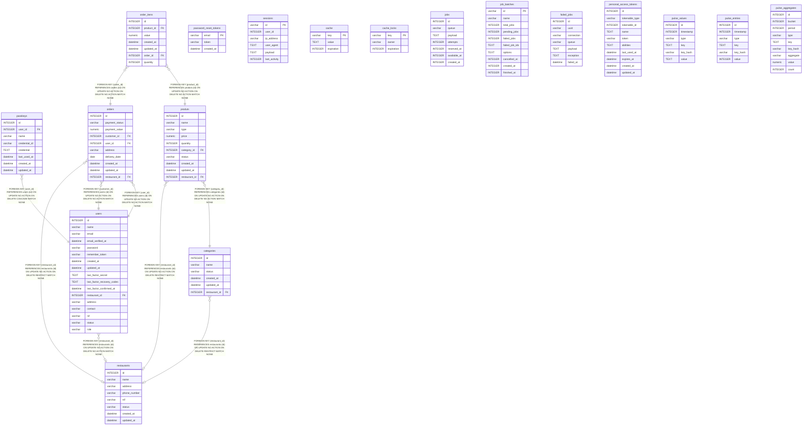

# database.sqlite

## Description

Documentação da base de dados do projeto

## Tables

| Name                                                | Columns | Comment | Type  |
| --------------------------------------------------- | ------- | ------- | ----- |
| [password_reset_tokens](password_reset_tokens.md)   | 3       |         | table |
| [sessions](sessions.md)                             | 6       |         | table |
| [cache](cache.md)                                   | 3       |         | table |
| [cache_locks](cache_locks.md)                       | 3       |         | table |
| [jobs](jobs.md)                                     | 7       |         | table |
| [job_batches](job_batches.md)                       | 10      |         | table |
| [failed_jobs](failed_jobs.md)                       | 7       |         | table |
| [passkeys](passkeys.md)                             | 8       |         | table |
| [restaurants](restaurants.md)                       | 8       |         | table |
| [users](users.md)                                   | 17      |         | table |
| [order_itens](order_itens.md)                       | 7       |         | table |
| [personal_access_tokens](personal_access_tokens.md) | 10      |         | table |
| [categories](categories.md)                         | 6       |         | table |
| [produts](produts.md)                               | 10      |         | table |
| [orders](orders.md)                                 | 10      |         | table |
| [pulse_values](pulse_values.md)                     | 6       |         | table |
| [pulse_entries](pulse_entries.md)                   | 6       |         | table |
| [pulse_aggregates](pulse_aggregates.md)             | 9       |         | table |

## Relations

---

> Generated by [tbls](https://github.com/k1LoW/tbls)
