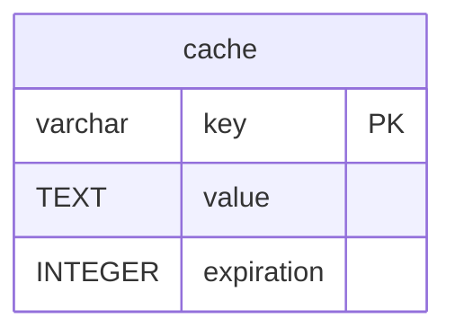

# cache

## Description

<details>
<summary><strong>Table Definition</strong></summary>

```sql
CREATE TABLE "cache" ("key" varchar not null, "value" text not null, "expiration" integer not null, primary key ("key"))
```

</details>

## Columns

| Name       | Type    | Default | Nullable | Children | Parents | Comment |
| ---------- | ------- | ------- | -------- | -------- | ------- | ------- |
| key        | varchar |         | false    |          |         |         |
| value      | TEXT    |         | false    |          |         |         |
| expiration | INTEGER |         | false    |          |         |         |

## Constraints

| Name                     | Type        | Definition        |
| ------------------------ | ----------- | ----------------- |
| key                      | PRIMARY KEY | PRIMARY KEY (key) |
| sqlite_autoindex_cache_1 | PRIMARY KEY | PRIMARY KEY (key) |

## Indexes

| Name                     | Definition                                                      |
| ------------------------ | --------------------------------------------------------------- |
| cache_expiration_index   | CREATE INDEX "cache_expiration_index" on "cache" ("expiration") |
| sqlite_autoindex_cache_1 | PRIMARY KEY (key)                                               |

## Relations



---

> Generated by [tbls](https://github.com/k1LoW/tbls)
