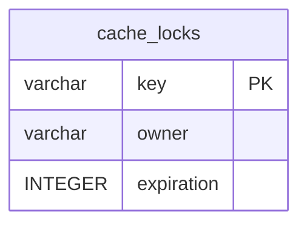

# cache_locks

## Description

<details>
<summary><strong>Table Definition</strong></summary>

```sql
CREATE TABLE "cache_locks" ("key" varchar not null, "owner" varchar not null, "expiration" integer not null, primary key ("key"))
```

</details>

## Columns

| Name       | Type    | Default | Nullable | Children | Parents | Comment |
| ---------- | ------- | ------- | -------- | -------- | ------- | ------- |
| key        | varchar |         | false    |          |         |         |
| owner      | varchar |         | false    |          |         |         |
| expiration | INTEGER |         | false    |          |         |         |

## Constraints

| Name                           | Type        | Definition        |
| ------------------------------ | ----------- | ----------------- |
| key                            | PRIMARY KEY | PRIMARY KEY (key) |
| sqlite_autoindex_cache_locks_1 | PRIMARY KEY | PRIMARY KEY (key) |

## Indexes

| Name                           | Definition                                                                  |
| ------------------------------ | --------------------------------------------------------------------------- |
| cache_locks_expiration_index   | CREATE INDEX "cache_locks_expiration_index" on "cache_locks" ("expiration") |
| sqlite_autoindex_cache_locks_1 | PRIMARY KEY (key)                                                           |

## Relations



---

> Generated by [tbls](https://github.com/k1LoW/tbls)
