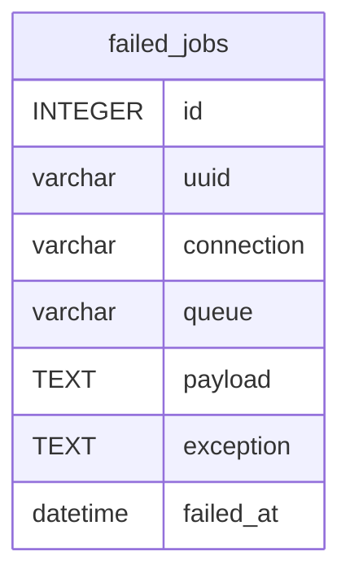

# failed_jobs

## Description

<details>
<summary><strong>Table Definition</strong></summary>

```sql
CREATE TABLE "failed_jobs" ("id" integer primary key autoincrement not null, "uuid" varchar not null, "connection" varchar not null, "queue" varchar not null, "payload" text not null, "exception" text not null, "failed_at" datetime not null default CURRENT_TIMESTAMP)
```

</details>

## Columns

| Name       | Type     | Default           | Nullable | Children | Parents | Comment |
| ---------- | -------- | ----------------- | -------- | -------- | ------- | ------- |
| id         | INTEGER  |                   | false    |          |         |         |
| uuid       | varchar  |                   | false    |          |         |         |
| connection | varchar  |                   | false    |          |         |         |
| queue      | varchar  |                   | false    |          |         |         |
| payload    | TEXT     |                   | false    |          |         |         |
| exception  | TEXT     |                   | false    |          |         |         |
| failed_at  | datetime | CURRENT_TIMESTAMP | false    |          |         |         |

## Constraints

| Name | Type        | Definition       |
| ---- | ----------- | ---------------- |
| id   | PRIMARY KEY | PRIMARY KEY (id) |

## Indexes

| Name                                         | Definition                                                                                                        |
| -------------------------------------------- | ----------------------------------------------------------------------------------------------------------------- |
| failed_jobs_uuid_unique                      | CREATE UNIQUE INDEX "failed_jobs_uuid_unique" on "failed_jobs" ("uuid")                                           |
| failed_jobs_connection_queue_failed_at_index | CREATE INDEX "failed_jobs_connection_queue_failed_at_index" on "failed_jobs" ("connection", "queue", "failed_at") |

## Relations



---

> Generated by [tbls](https://github.com/k1LoW/tbls)
