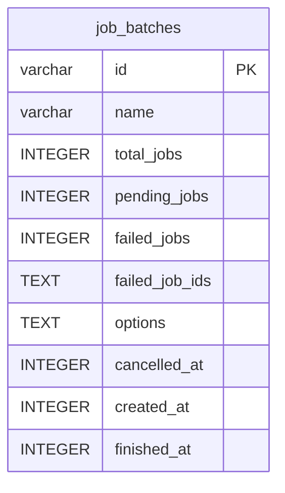

# job_batches

## Description

<details>
<summary><strong>Table Definition</strong></summary>

```sql
CREATE TABLE "job_batches" ("id" varchar not null, "name" varchar not null, "total_jobs" integer not null, "pending_jobs" integer not null, "failed_jobs" integer not null, "failed_job_ids" text not null, "options" text, "cancelled_at" integer, "created_at" integer not null, "finished_at" integer, primary key ("id"))
```

</details>

## Columns

| Name           | Type    | Default | Nullable | Children | Parents | Comment |
| -------------- | ------- | ------- | -------- | -------- | ------- | ------- |
| id             | varchar |         | false    |          |         |         |
| name           | varchar |         | false    |          |         |         |
| total_jobs     | INTEGER |         | false    |          |         |         |
| pending_jobs   | INTEGER |         | false    |          |         |         |
| failed_jobs    | INTEGER |         | false    |          |         |         |
| failed_job_ids | TEXT    |         | false    |          |         |         |
| options        | TEXT    |         | true     |          |         |         |
| cancelled_at   | INTEGER |         | true     |          |         |         |
| created_at     | INTEGER |         | false    |          |         |         |
| finished_at    | INTEGER |         | true     |          |         |         |

## Constraints

| Name                           | Type        | Definition       |
| ------------------------------ | ----------- | ---------------- |
| id                             | PRIMARY KEY | PRIMARY KEY (id) |
| sqlite_autoindex_job_batches_1 | PRIMARY KEY | PRIMARY KEY (id) |

## Indexes

| Name                           | Definition       |
| ------------------------------ | ---------------- |
| sqlite_autoindex_job_batches_1 | PRIMARY KEY (id) |

## Relations



---

> Generated by [tbls](https://github.com/k1LoW/tbls)
