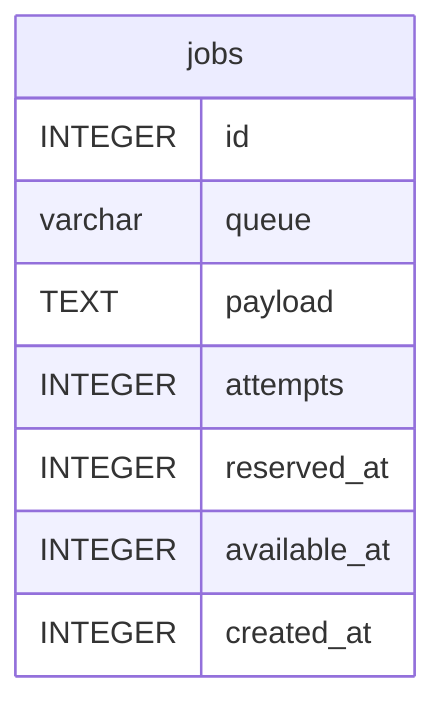

# jobs

## Description

<details>
<summary><strong>Table Definition</strong></summary>

```sql
CREATE TABLE "jobs" ("id" integer primary key autoincrement not null, "queue" varchar not null, "payload" text not null, "attempts" integer not null, "reserved_at" integer, "available_at" integer not null, "created_at" integer not null)
```

</details>

## Columns

| Name         | Type    | Default | Nullable | Children | Parents | Comment |
| ------------ | ------- | ------- | -------- | -------- | ------- | ------- |
| id           | INTEGER |         | false    |          |         |         |
| queue        | varchar |         | false    |          |         |         |
| payload      | TEXT    |         | false    |          |         |         |
| attempts     | INTEGER |         | false    |          |         |         |
| reserved_at  | INTEGER |         | true     |          |         |         |
| available_at | INTEGER |         | false    |          |         |         |
| created_at   | INTEGER |         | false    |          |         |         |

## Constraints

| Name | Type        | Definition       |
| ---- | ----------- | ---------------- |
| id   | PRIMARY KEY | PRIMARY KEY (id) |

## Indexes

| Name             | Definition                                          |
| ---------------- | --------------------------------------------------- |
| jobs_queue_index | CREATE INDEX "jobs_queue_index" on "jobs" ("queue") |

## Relations



---

> Generated by [tbls](https://github.com/k1LoW/tbls)
