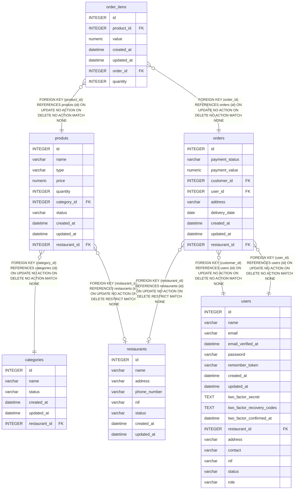

# order_itens

## Description

<details>
<summary><strong>Table Definition</strong></summary>

```sql
CREATE TABLE "order_itens" ("id" integer primary key autoincrement not null, "product_id" integer not null, "value" numeric not null, "created_at" datetime, "updated_at" datetime, "order_id" integer not null, "quantity" integer not null default '1', foreign key("product_id") references "produts"("id") on delete no action on update no action, foreign key("order_id") references "orders"("id"))
```

</details>

## Columns

| Name       | Type     | Default | Nullable | Children | Parents               | Comment |
| ---------- | -------- | ------- | -------- | -------- | --------------------- | ------- |
| id         | INTEGER  |         | false    |          |                       |         |
| product_id | INTEGER  |         | false    |          | [produts](produts.md) |         |
| value      | numeric  |         | false    |          |                       |         |
| created_at | datetime |         | true     |          |                       |         |
| updated_at | datetime |         | true     |          |                       |         |
| order_id   | INTEGER  |         | false    |          | [orders](orders.md)   |         |
| quantity   | INTEGER  | '1'     | false    |          |                       |         |

## Constraints

| Name                  | Type        | Definition                                                                                          |
| --------------------- | ----------- | --------------------------------------------------------------------------------------------------- |
| id                    | PRIMARY KEY | PRIMARY KEY (id)                                                                                    |
| - (Foreign key ID: 0) | FOREIGN KEY | FOREIGN KEY (order_id) REFERENCES orders (id) ON UPDATE NO ACTION ON DELETE NO ACTION MATCH NONE    |
| - (Foreign key ID: 1) | FOREIGN KEY | FOREIGN KEY (product_id) REFERENCES produts (id) ON UPDATE NO ACTION ON DELETE NO ACTION MATCH NONE |

## Relations



---

> Generated by [tbls](https://github.com/k1LoW/tbls)
