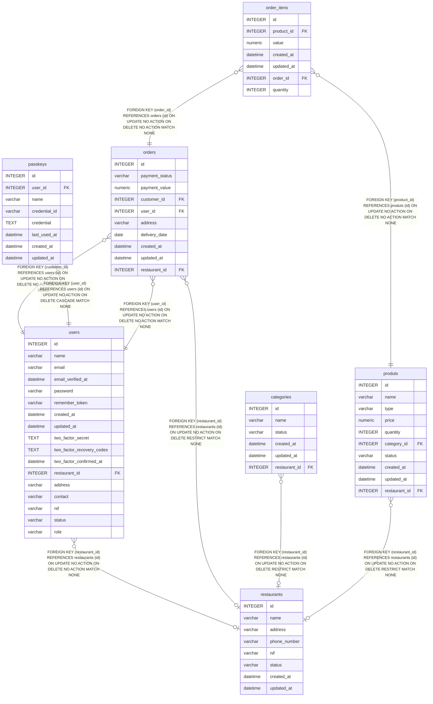

# orders

## Description

<details>
<summary><strong>Table Definition</strong></summary>

```sql
CREATE TABLE "orders" ("id" integer primary key autoincrement not null, "payment_status" varchar not null default ('pending'), "payment_value" numeric not null default ('0'), "customer_id" integer not null, "user_id" integer not null, "address" varchar not null, "delivery_date" date not null, "created_at" datetime, "updated_at" datetime, "restaurant_id" integer, foreign key("user_id") references "users"("id") on delete no action on update no action, foreign key("customer_id") references "users"("id") on delete no action on update no action, foreign key("restaurant_id") references "restaurants"("id") on delete restrict)
```

</details>

## Columns

| Name           | Type     | Default   | Nullable | Children                      | Parents                       | Comment |
| -------------- | -------- | --------- | -------- | ----------------------------- | ----------------------------- | ------- |
| id             | INTEGER  |           | false    | [order_itens](order_itens.md) |                               |         |
| payment_status | varchar  | 'pending' | false    |                               |                               |         |
| payment_value  | numeric  | '0'       | false    |                               |                               |         |
| customer_id    | INTEGER  |           | false    |                               | [users](users.md)             |         |
| user_id        | INTEGER  |           | false    |                               | [users](users.md)             |         |
| address        | varchar  |           | false    |                               |                               |         |
| delivery_date  | date     |           | false    |                               |                               |         |
| created_at     | datetime |           | true     |                               |                               |         |
| updated_at     | datetime |           | true     |                               |                               |         |
| restaurant_id  | INTEGER  |           | true     |                               | [restaurants](restaurants.md) |         |

## Constraints

| Name                  | Type        | Definition                                                                                                |
| --------------------- | ----------- | --------------------------------------------------------------------------------------------------------- |
| id                    | PRIMARY KEY | PRIMARY KEY (id)                                                                                          |
| - (Foreign key ID: 0) | FOREIGN KEY | FOREIGN KEY (restaurant_id) REFERENCES restaurants (id) ON UPDATE NO ACTION ON DELETE RESTRICT MATCH NONE |
| - (Foreign key ID: 1) | FOREIGN KEY | FOREIGN KEY (customer_id) REFERENCES users (id) ON UPDATE NO ACTION ON DELETE NO ACTION MATCH NONE        |
| - (Foreign key ID: 2) | FOREIGN KEY | FOREIGN KEY (user_id) REFERENCES users (id) ON UPDATE NO ACTION ON DELETE NO ACTION MATCH NONE            |

## Relations



---

> Generated by [tbls](https://github.com/k1LoW/tbls)
