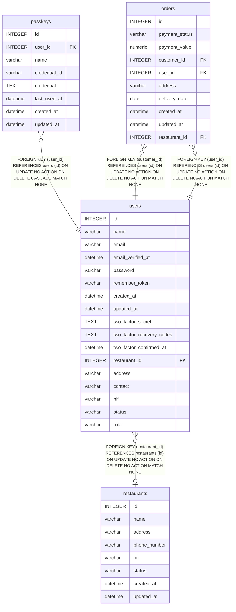

# passkeys

## Description

<details>
<summary><strong>Table Definition</strong></summary>

```sql
CREATE TABLE "passkeys" ("id" integer primary key autoincrement not null, "user_id" integer not null, "name" varchar not null, "credential_id" varchar not null, "credential" text not null, "last_used_at" datetime, "created_at" datetime, "updated_at" datetime, foreign key("user_id") references "users"("id") on delete cascade)
```

</details>

## Columns

| Name          | Type     | Default | Nullable | Children | Parents           | Comment |
| ------------- | -------- | ------- | -------- | -------- | ----------------- | ------- |
| id            | INTEGER  |         | false    |          |                   |         |
| user_id       | INTEGER  |         | false    |          | [users](users.md) |         |
| name          | varchar  |         | false    |          |                   |         |
| credential_id | varchar  |         | false    |          |                   |         |
| credential    | TEXT     |         | false    |          |                   |         |
| last_used_at  | datetime |         | true     |          |                   |         |
| created_at    | datetime |         | true     |          |                   |         |
| updated_at    | datetime |         | true     |          |                   |         |

## Constraints

| Name                  | Type        | Definition                                                                                   |
| --------------------- | ----------- | -------------------------------------------------------------------------------------------- |
| id                    | PRIMARY KEY | PRIMARY KEY (id)                                                                             |
| - (Foreign key ID: 0) | FOREIGN KEY | FOREIGN KEY (user_id) REFERENCES users (id) ON UPDATE NO ACTION ON DELETE CASCADE MATCH NONE |

## Indexes

| Name                          | Definition                                                                          |
| ----------------------------- | ----------------------------------------------------------------------------------- |
| passkeys_credential_id_unique | CREATE UNIQUE INDEX "passkeys_credential_id_unique" on "passkeys" ("credential_id") |
| passkeys_user_id_index        | CREATE INDEX "passkeys_user_id_index" on "passkeys" ("user_id")                     |

## Relations



---

> Generated by [tbls](https://github.com/k1LoW/tbls)
