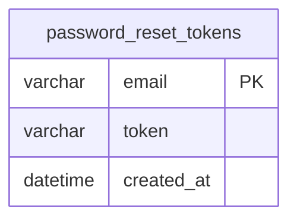

# password_reset_tokens

## Description

<details>
<summary><strong>Table Definition</strong></summary>

```sql
CREATE TABLE "password_reset_tokens" ("email" varchar not null, "token" varchar not null, "created_at" datetime, primary key ("email"))
```

</details>

## Columns

| Name       | Type     | Default | Nullable | Children | Parents | Comment |
| ---------- | -------- | ------- | -------- | -------- | ------- | ------- |
| email      | varchar  |         | false    |          |         |         |
| token      | varchar  |         | false    |          |         |         |
| created_at | datetime |         | true     |          |         |         |

## Constraints

| Name                                     | Type        | Definition          |
| ---------------------------------------- | ----------- | ------------------- |
| email                                    | PRIMARY KEY | PRIMARY KEY (email) |
| sqlite_autoindex_password_reset_tokens_1 | PRIMARY KEY | PRIMARY KEY (email) |

## Indexes

| Name                                     | Definition          |
| ---------------------------------------- | ------------------- |
| sqlite_autoindex_password_reset_tokens_1 | PRIMARY KEY (email) |

## Relations



---

> Generated by [tbls](https://github.com/k1LoW/tbls)
