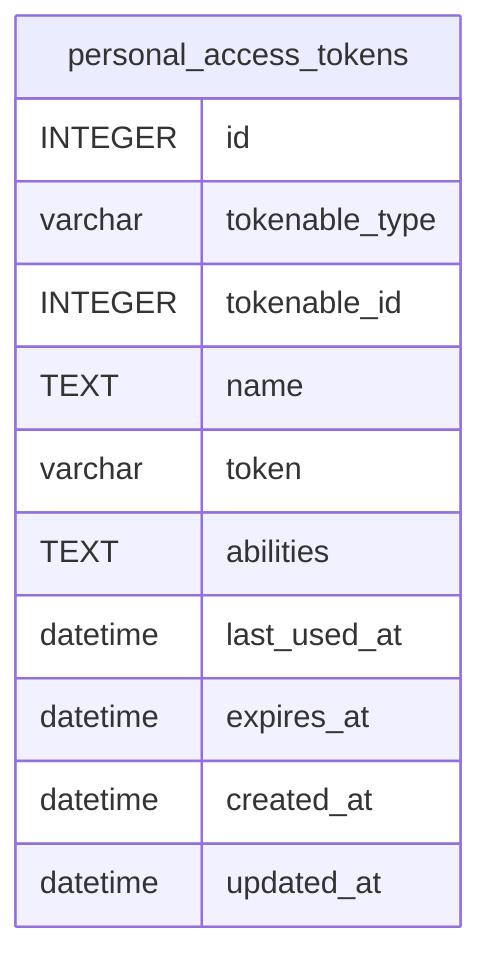

# personal_access_tokens

## Description

<details>
<summary><strong>Table Definition</strong></summary>

```sql
CREATE TABLE "personal_access_tokens" ("id" integer primary key autoincrement not null, "tokenable_type" varchar not null, "tokenable_id" integer not null, "name" text not null, "token" varchar not null, "abilities" text, "last_used_at" datetime, "expires_at" datetime, "created_at" datetime, "updated_at" datetime)
```

</details>

## Columns

| Name           | Type     | Default | Nullable | Children | Parents | Comment |
| -------------- | -------- | ------- | -------- | -------- | ------- | ------- |
| id             | INTEGER  |         | false    |          |         |         |
| tokenable_type | varchar  |         | false    |          |         |         |
| tokenable_id   | INTEGER  |         | false    |          |         |         |
| name           | TEXT     |         | false    |          |         |         |
| token          | varchar  |         | false    |          |         |         |
| abilities      | TEXT     |         | true     |          |         |         |
| last_used_at   | datetime |         | true     |          |         |         |
| expires_at     | datetime |         | true     |          |         |         |
| created_at     | datetime |         | true     |          |         |         |
| updated_at     | datetime |         | true     |          |         |         |

## Constraints

| Name | Type        | Definition       |
| ---- | ----------- | ---------------- |
| id   | PRIMARY KEY | PRIMARY KEY (id) |

## Indexes

| Name                                                     | Definition                                                                                                                             |
| -------------------------------------------------------- | -------------------------------------------------------------------------------------------------------------------------------------- |
| personal_access_tokens_expires_at_index                  | CREATE INDEX "personal_access_tokens_expires_at_index" on "personal_access_tokens" ("expires_at")                                      |
| personal_access_tokens_token_unique                      | CREATE UNIQUE INDEX "personal_access_tokens_token_unique" on "personal_access_tokens" ("token")                                        |
| personal_access_tokens_tokenable_type_tokenable_id_index | CREATE INDEX "personal_access_tokens_tokenable_type_tokenable_id_index" on "personal_access_tokens" ("tokenable_type", "tokenable_id") |

## Relations



---

> Generated by [tbls](https://github.com/k1LoW/tbls)
