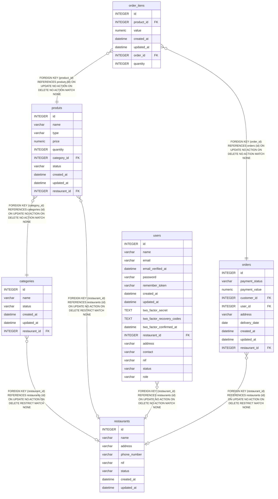

# produts

## Description

<details>
<summary><strong>Table Definition</strong></summary>

```sql
CREATE TABLE "produts" ("id" integer primary key autoincrement not null, "name" varchar not null, "type" varchar not null, "price" numeric not null, "quantity" integer not null, "category_id" integer not null, "status" varchar not null default ('active'), "created_at" datetime, "updated_at" datetime, "restaurant_id" integer, foreign key("category_id") references "categories"("id") on delete no action on update no action, foreign key("restaurant_id") references "restaurants"("id") on delete restrict)
```

</details>

## Columns

| Name          | Type     | Default  | Nullable | Children                      | Parents                       | Comment |
| ------------- | -------- | -------- | -------- | ----------------------------- | ----------------------------- | ------- |
| id            | INTEGER  |          | false    | [order_itens](order_itens.md) |                               |         |
| name          | varchar  |          | false    |                               |                               |         |
| type          | varchar  |          | false    |                               |                               |         |
| price         | numeric  |          | false    |                               |                               |         |
| quantity      | INTEGER  |          | false    |                               |                               |         |
| category_id   | INTEGER  |          | false    |                               | [categories](categories.md)   |         |
| status        | varchar  | 'active' | false    |                               |                               |         |
| created_at    | datetime |          | true     |                               |                               |         |
| updated_at    | datetime |          | true     |                               |                               |         |
| restaurant_id | INTEGER  |          | true     |                               | [restaurants](restaurants.md) |         |

## Constraints

| Name                  | Type        | Definition                                                                                                |
| --------------------- | ----------- | --------------------------------------------------------------------------------------------------------- |
| id                    | PRIMARY KEY | PRIMARY KEY (id)                                                                                          |
| - (Foreign key ID: 0) | FOREIGN KEY | FOREIGN KEY (restaurant_id) REFERENCES restaurants (id) ON UPDATE NO ACTION ON DELETE RESTRICT MATCH NONE |
| - (Foreign key ID: 1) | FOREIGN KEY | FOREIGN KEY (category_id) REFERENCES categories (id) ON UPDATE NO ACTION ON DELETE NO ACTION MATCH NONE   |

## Relations



---

> Generated by [tbls](https://github.com/k1LoW/tbls)
