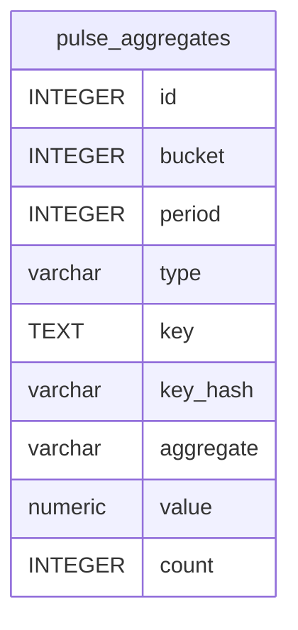

# pulse_aggregates

## Description

<details>
<summary><strong>Table Definition</strong></summary>

```sql
CREATE TABLE "pulse_aggregates" ("id" integer primary key autoincrement not null, "bucket" integer not null, "period" integer not null, "type" varchar not null, "key" text not null, "key_hash" varchar not null, "aggregate" varchar not null, "value" numeric not null, "count" integer)
```

</details>

## Columns

| Name      | Type    | Default | Nullable | Children | Parents | Comment |
| --------- | ------- | ------- | -------- | -------- | ------- | ------- |
| id        | INTEGER |         | false    |          |         |         |
| bucket    | INTEGER |         | false    |          |         |         |
| period    | INTEGER |         | false    |          |         |         |
| type      | varchar |         | false    |          |         |         |
| key       | TEXT    |         | false    |          |         |         |
| key_hash  | varchar |         | false    |          |         |         |
| aggregate | varchar |         | false    |          |         |         |
| value     | numeric |         | false    |          |         |         |
| count     | INTEGER |         | true     |          |         |         |

## Constraints

| Name | Type        | Definition       |
| ---- | ----------- | ---------------- |
| id   | PRIMARY KEY | PRIMARY KEY (id) |

## Indexes

| Name                                                          | Definition                                                                                                                                                      |
| ------------------------------------------------------------- | --------------------------------------------------------------------------------------------------------------------------------------------------------------- |
| pulse_aggregates_period_type_aggregate_bucket_index           | CREATE INDEX "pulse_aggregates_period_type_aggregate_bucket_index" on "pulse_aggregates" ("period", "type", "aggregate", "bucket")                              |
| pulse_aggregates_type_index                                   | CREATE INDEX "pulse_aggregates_type_index" on "pulse_aggregates" ("type")                                                                                       |
| pulse_aggregates_period_bucket_index                          | CREATE INDEX "pulse_aggregates_period_bucket_index" on "pulse_aggregates" ("period", "bucket")                                                                  |
| pulse_aggregates_bucket_period_type_aggregate_key_hash_unique | CREATE UNIQUE INDEX "pulse_aggregates_bucket_period_type_aggregate_key_hash_unique" on "pulse_aggregates" ("bucket", "period", "type", "aggregate", "key_hash") |

## Relations



---

> Generated by [tbls](https://github.com/k1LoW/tbls)
