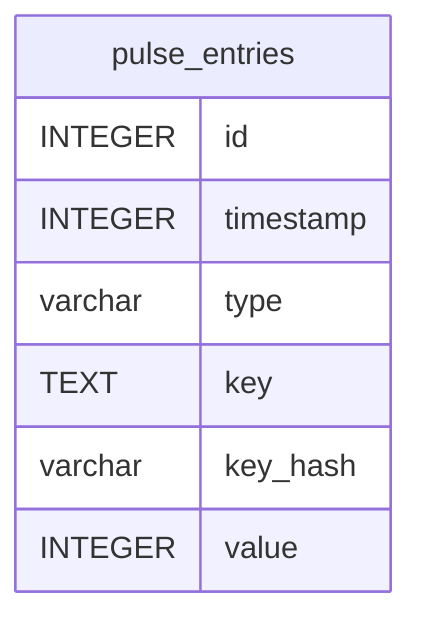

# pulse_entries

## Description

<details>
<summary><strong>Table Definition</strong></summary>

```sql
CREATE TABLE "pulse_entries" ("id" integer primary key autoincrement not null, "timestamp" integer not null, "type" varchar not null, "key" text not null, "key_hash" varchar not null, "value" integer)
```

</details>

## Columns

| Name      | Type    | Default | Nullable | Children | Parents | Comment |
| --------- | ------- | ------- | -------- | -------- | ------- | ------- |
| id        | INTEGER |         | false    |          |         |         |
| timestamp | INTEGER |         | false    |          |         |         |
| type      | varchar |         | false    |          |         |         |
| key       | TEXT    |         | false    |          |         |         |
| key_hash  | varchar |         | false    |          |         |         |
| value     | INTEGER |         | true     |          |         |         |

## Constraints

| Name | Type        | Definition       |
| ---- | ----------- | ---------------- |
| id   | PRIMARY KEY | PRIMARY KEY (id) |

## Indexes

| Name                                              | Definition                                                                                                                     |
| ------------------------------------------------- | ------------------------------------------------------------------------------------------------------------------------------ |
| pulse_entries_timestamp_type_key_hash_value_index | CREATE INDEX "pulse_entries_timestamp_type_key_hash_value_index" on "pulse_entries" ("timestamp", "type", "key_hash", "value") |
| pulse_entries_key_hash_index                      | CREATE INDEX "pulse_entries_key_hash_index" on "pulse_entries" ("key_hash")                                                    |
| pulse_entries_type_index                          | CREATE INDEX "pulse_entries_type_index" on "pulse_entries" ("type")                                                            |
| pulse_entries_timestamp_index                     | CREATE INDEX "pulse_entries_timestamp_index" on "pulse_entries" ("timestamp")                                                  |

## Relations



---

> Generated by [tbls](https://github.com/k1LoW/tbls)
