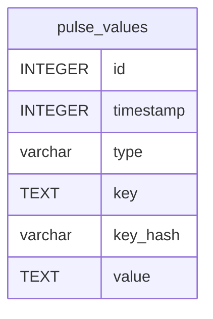

# pulse_values

## Description

<details>
<summary><strong>Table Definition</strong></summary>

```sql
CREATE TABLE "pulse_values" ("id" integer primary key autoincrement not null, "timestamp" integer not null, "type" varchar not null, "key" text not null, "key_hash" varchar not null, "value" text not null)
```

</details>

## Columns

| Name      | Type    | Default | Nullable | Children | Parents | Comment |
| --------- | ------- | ------- | -------- | -------- | ------- | ------- |
| id        | INTEGER |         | false    |          |         |         |
| timestamp | INTEGER |         | false    |          |         |         |
| type      | varchar |         | false    |          |         |         |
| key       | TEXT    |         | false    |          |         |         |
| key_hash  | varchar |         | false    |          |         |         |
| value     | TEXT    |         | false    |          |         |         |

## Constraints

| Name | Type        | Definition       |
| ---- | ----------- | ---------------- |
| id   | PRIMARY KEY | PRIMARY KEY (id) |

## Indexes

| Name                              | Definition                                                                                     |
| --------------------------------- | ---------------------------------------------------------------------------------------------- |
| pulse_values_type_key_hash_unique | CREATE UNIQUE INDEX "pulse_values_type_key_hash_unique" on "pulse_values" ("type", "key_hash") |
| pulse_values_type_index           | CREATE INDEX "pulse_values_type_index" on "pulse_values" ("type")                              |
| pulse_values_timestamp_index      | CREATE INDEX "pulse_values_timestamp_index" on "pulse_values" ("timestamp")                    |

## Relations



---

> Generated by [tbls](https://github.com/k1LoW/tbls)
