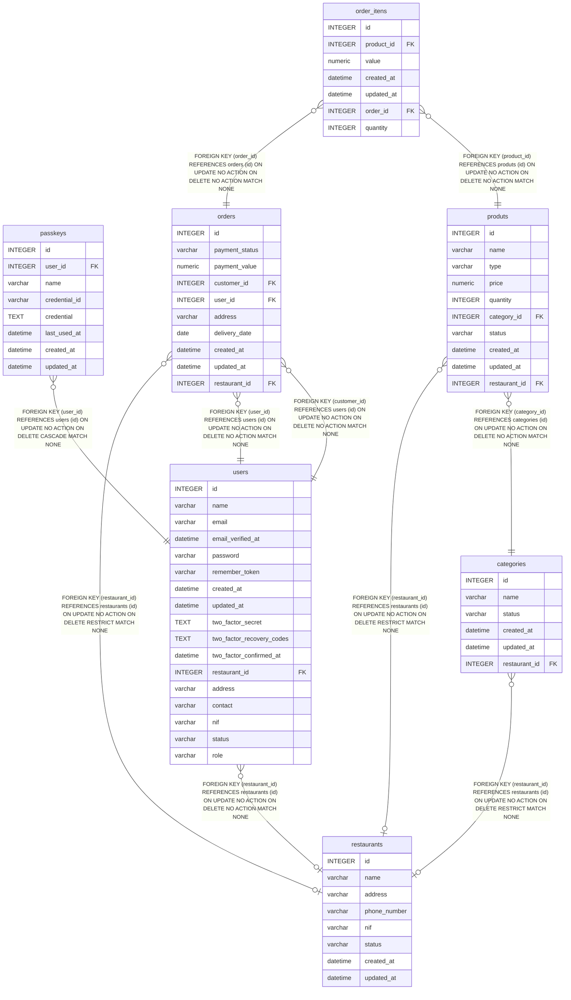

# restaurants

## Description

<details>
<summary><strong>Table Definition</strong></summary>

```sql
CREATE TABLE "restaurants" ("id" integer primary key autoincrement not null, "name" varchar not null, "address" varchar not null, "phone_number" varchar not null, "nif" varchar not null, "status" varchar check ("status" in ('active', 'inactive')) not null default 'active', "created_at" datetime, "updated_at" datetime)
```

</details>

## Columns

| Name         | Type     | Default  | Nullable | Children                                                                                | Parents | Comment |
| ------------ | -------- | -------- | -------- | --------------------------------------------------------------------------------------- | ------- | ------- |
| id           | INTEGER  |          | false    | [users](users.md) [categories](categories.md) [produts](produts.md) [orders](orders.md) |         |         |
| name         | varchar  |          | false    |                                                                                         |         |         |
| address      | varchar  |          | false    |                                                                                         |         |         |
| phone_number | varchar  |          | false    |                                                                                         |         |         |
| nif          | varchar  |          | false    |                                                                                         |         |         |
| status       | varchar  | 'active' | false    |                                                                                         |         |         |
| created_at   | datetime |          | true     |                                                                                         |         |         |
| updated_at   | datetime |          | true     |                                                                                         |         |         |

## Constraints

| Name | Type        | Definition                                 |
| ---- | ----------- | ------------------------------------------ |
| id   | PRIMARY KEY | PRIMARY KEY (id)                           |
| -    | CHECK       | check ("status" in ('active', 'inactive')) |

## Indexes

| Name                   | Definition                                                            |
| ---------------------- | --------------------------------------------------------------------- |
| restaurants_nif_unique | CREATE UNIQUE INDEX "restaurants_nif_unique" on "restaurants" ("nif") |

## Relations



---

> Generated by [tbls](https://github.com/k1LoW/tbls)
