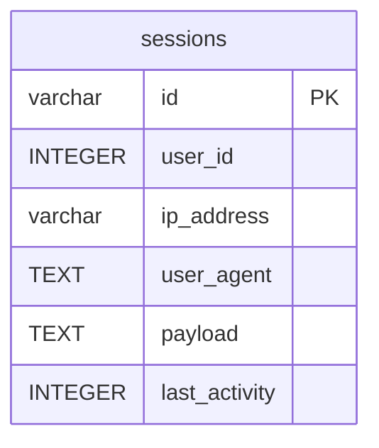

# sessions

## Description

<details>
<summary><strong>Table Definition</strong></summary>

```sql
CREATE TABLE "sessions" ("id" varchar not null, "user_id" integer, "ip_address" varchar, "user_agent" text, "payload" text not null, "last_activity" integer not null, primary key ("id"))
```

</details>

## Columns

| Name          | Type    | Default | Nullable | Children | Parents | Comment |
| ------------- | ------- | ------- | -------- | -------- | ------- | ------- |
| id            | varchar |         | false    |          |         |         |
| user_id       | INTEGER |         | true     |          |         |         |
| ip_address    | varchar |         | true     |          |         |         |
| user_agent    | TEXT    |         | true     |          |         |         |
| payload       | TEXT    |         | false    |          |         |         |
| last_activity | INTEGER |         | false    |          |         |         |

## Constraints

| Name                        | Type        | Definition       |
| --------------------------- | ----------- | ---------------- |
| id                          | PRIMARY KEY | PRIMARY KEY (id) |
| sqlite_autoindex_sessions_1 | PRIMARY KEY | PRIMARY KEY (id) |

## Indexes

| Name                         | Definition                                                                  |
| ---------------------------- | --------------------------------------------------------------------------- |
| sessions_last_activity_index | CREATE INDEX "sessions_last_activity_index" on "sessions" ("last_activity") |
| sessions_user_id_index       | CREATE INDEX "sessions_user_id_index" on "sessions" ("user_id")             |
| sqlite_autoindex_sessions_1  | PRIMARY KEY (id)                                                            |

## Relations



---

> Generated by [tbls](https://github.com/k1LoW/tbls)
