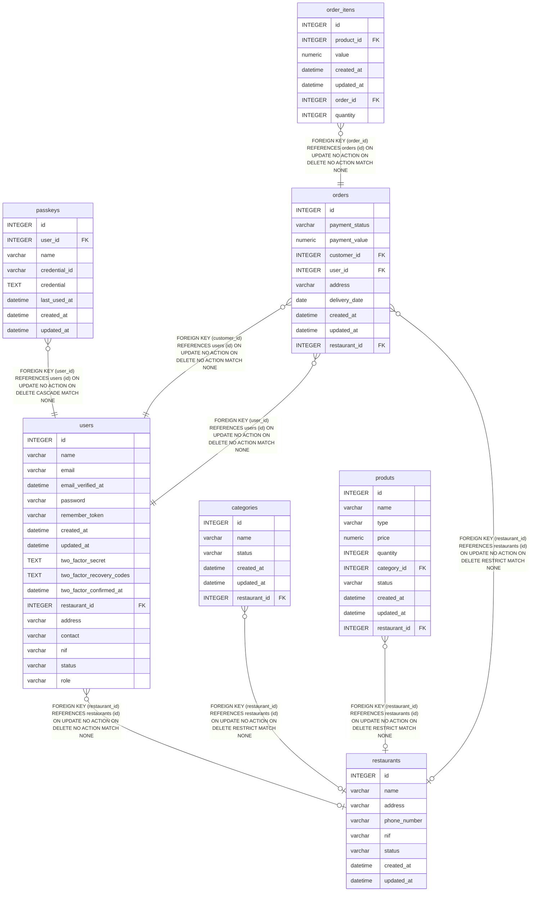

# users

## Description

<details>
<summary><strong>Table Definition</strong></summary>

```sql
CREATE TABLE "users" ("id" integer primary key autoincrement not null, "name" varchar not null, "email" varchar not null, "email_verified_at" datetime, "password" varchar not null, "remember_token" varchar, "created_at" datetime, "updated_at" datetime, "two_factor_secret" text, "two_factor_recovery_codes" text, "two_factor_confirmed_at" datetime, "restaurant_id" integer, "address" varchar, "contact" varchar, "nif" varchar, "status" varchar check ("status" in ('active', 'inactive')) not null default 'active', "role" varchar not null default 'customer', foreign key("restaurant_id") references "restaurants"("id"))
```

</details>

## Columns

| Name                      | Type     | Default    | Nullable | Children                                    | Parents                       | Comment |
| ------------------------- | -------- | ---------- | -------- | ------------------------------------------- | ----------------------------- | ------- |
| id                        | INTEGER  |            | false    | [passkeys](passkeys.md) [orders](orders.md) |                               |         |
| name                      | varchar  |            | false    |                                             |                               |         |
| email                     | varchar  |            | false    |                                             |                               |         |
| email_verified_at         | datetime |            | true     |                                             |                               |         |
| password                  | varchar  |            | false    |                                             |                               |         |
| remember_token            | varchar  |            | true     |                                             |                               |         |
| created_at                | datetime |            | true     |                                             |                               |         |
| updated_at                | datetime |            | true     |                                             |                               |         |
| two_factor_secret         | TEXT     |            | true     |                                             |                               |         |
| two_factor_recovery_codes | TEXT     |            | true     |                                             |                               |         |
| two_factor_confirmed_at   | datetime |            | true     |                                             |                               |         |
| restaurant_id             | INTEGER  |            | true     |                                             | [restaurants](restaurants.md) |         |
| address                   | varchar  |            | true     |                                             |                               |         |
| contact                   | varchar  |            | true     |                                             |                               |         |
| nif                       | varchar  |            | true     |                                             |                               |         |
| status                    | varchar  | 'active'   | false    |                                             |                               |         |
| role                      | varchar  | 'customer' | false    |                                             |                               |         |

## Constraints

| Name                  | Type        | Definition                                                                                                 |
| --------------------- | ----------- | ---------------------------------------------------------------------------------------------------------- |
| id                    | PRIMARY KEY | PRIMARY KEY (id)                                                                                           |
| - (Foreign key ID: 0) | FOREIGN KEY | FOREIGN KEY (restaurant_id) REFERENCES restaurants (id) ON UPDATE NO ACTION ON DELETE NO ACTION MATCH NONE |
| -                     | CHECK       | check ("status" in ('active', 'inactive'))                                                                 |

## Indexes

| Name               | Definition                                                    |
| ------------------ | ------------------------------------------------------------- |
| users_role_index   | CREATE INDEX "users_role_index" on "users" ("role")           |
| users_email_unique | CREATE UNIQUE INDEX "users_email_unique" on "users" ("email") |

## Relations



---

> Generated by [tbls](https://github.com/k1LoW/tbls)
